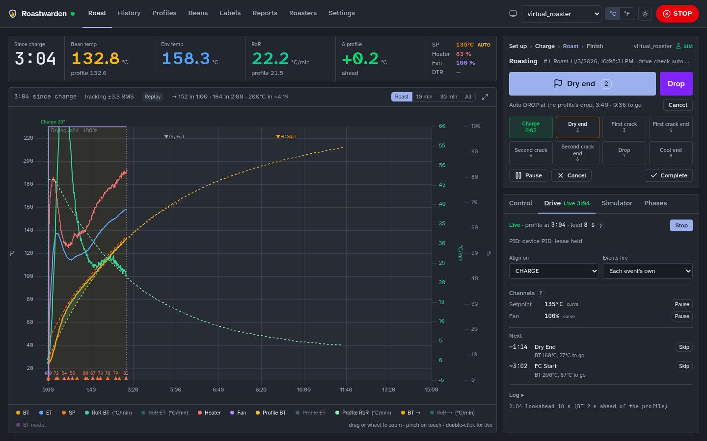
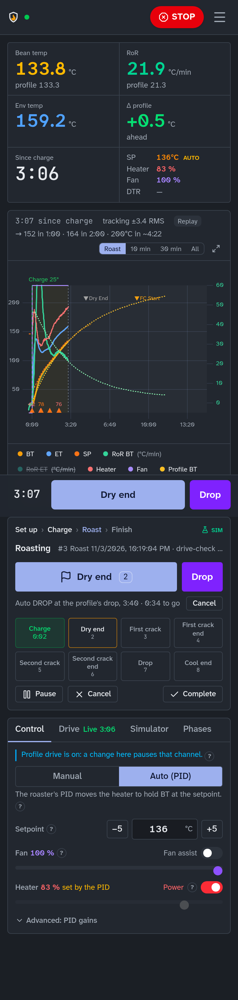
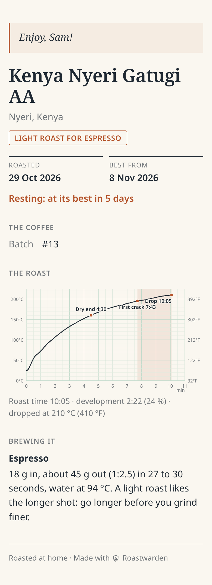
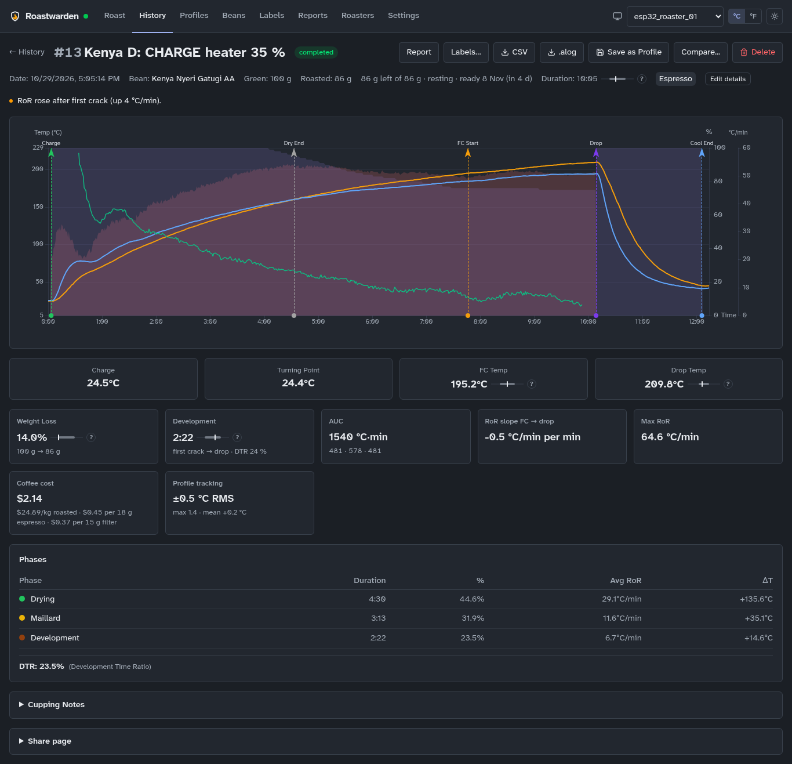
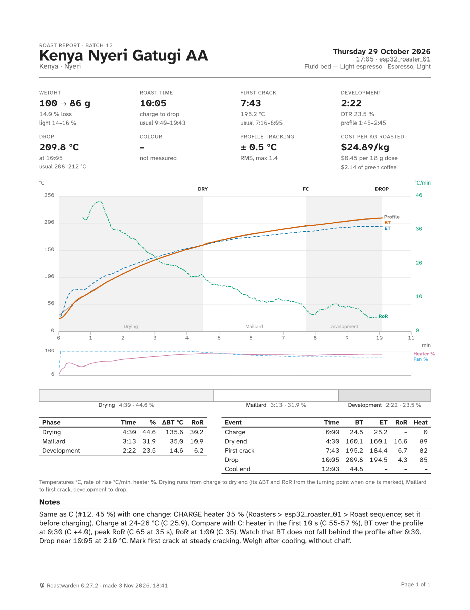
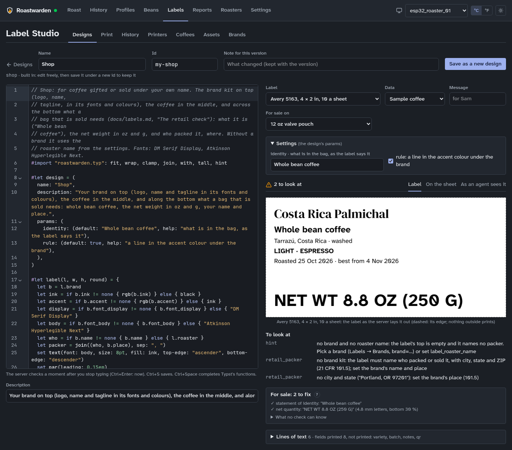
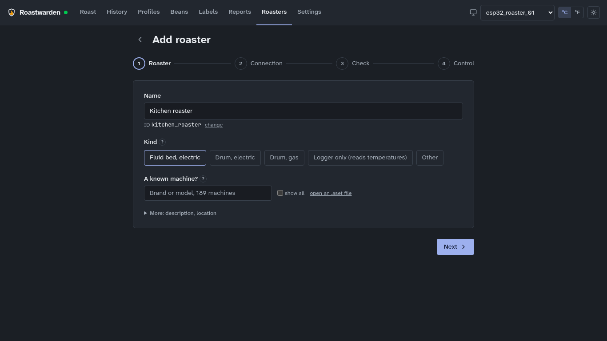

<picture>
  <source media="(prefers-color-scheme: dark)" srcset="docs/images/brand-dark.png">
  
</picture>

*Self-hosted coffee roasting software, written in Rust.* Understand every roast, build on every
batch: [roastwarden.com](https://roastwarden.com), or roast on a simulated roaster in the
[demo](https://demo.roastwarden.com). Formerly rustRoast (renamed in 0.25.0; an install
made as rustRoast upgrades in place: see `docs/DEPLOY.md`, "Upgrading from rustRoast").

A Rust server and web dashboard for coffee roasters, built as a server-centric replacement for
Artisan. The server talks to the roaster and runs the roast (recording, Profile drive, alarms,
fan assist, auto events, the roast sequence); every browser, phones included, is a view of it,
and a roast carries on with no browser open. Day-to-day use is in `docs/USER-GUIDE.md`.

**Status: public beta.** It runs the maintainer's own roaster every week. A release may still
change the API and the `roast` commands (`CHANGELOG.md` says so when one does), and the stored
data is carried forward by migrations. Roastwarden is developed with AI assistance, under the
maintainer's design and review.



- **Server** (`crates/server`): Axum HTTP/WebSocket API on SQLite. Roast sessions, profiles
  (shared by a public link, imported from another server's) and events; server-side profile replay with auto DROP; alarms and auto events (turning point,
  dry end, DROP); fan assist and a gain schedule; the server-run PID autotune
  (Autotune 2); one canonical rate of rise for every transport; the roaster's own model that
  predicts BT, first crack and DROP, warns before an RoR crash, flick or stall, and scores
  itself (`docs/prediction.md`); roast analysis
  and comparison; cupping.
- **Coffee**: green coffee purchases, stock and cost per roast, supplier links, a shopping
  list that becomes one cart link per supplier, and orders recorded from their receipts
  (checked to the cent, on order until received, the receipts kept privately)
  (`docs/green-coffee.md`); planned roasts and batch numbers (`docs/batches.md`); roasted
  coffee with its rest window, small batches in one bag as one lot and blends of several coffees with each origin on the label (`docs/roasted.md`); a new bean's first-roast guide
  (`docs/new-bean.md`).
- **Paper**: bag labels designed in Typst, printed over IPP, with a public share page per roast
  behind each QR code (`docs/labels.md`); PDF reports of a roast, two roasts compared, a
  profile, a coffee, a period, the plan, inventory, purchases and the shopping list
  (`docs/reports.md`).
- **Agents and scripts**: the `roast` CLI (`docs/cli.md`) and its Agent Skill
  (`skills/roastwarden/`, built into `roast`), scoped API tokens, approvals and an audit log
  (`docs/agents.md`). An agent is set up in three commands: `roast login <server>`,
  `roast skill install claude-code | hermes | agents`, `roast status`.
- **Secure by default** (`SECURITY.md`): an owner key made at first start, browsers that sign
  in once for an HttpOnly cookie (never keeping the key), reads behind the sign-in unless the
  install opens them, wrong keys rate limited, and a broker with no anonymous clients where
  each roaster may use only its own topics.
- **Transports**: MQTT (default, TLS optional), device WebSockets (inbound and outbound), Modbus
  TCP and Modbus RTU or ASCII (RS-485) masters (poll + write, for PID controllers and commercial
  drums; BCD values too),
  serial TC4/aArtisan (stock aArtisan's `CHAN` replies or Roastwarden's own), Phidgets
  temperature boards (1048, TMP1101, TMP1200, …) through Phidgets' network server
  (`docs/phidgets.md`), and a Modbus TCP slave so Artisan or an HMI can sit alongside
  (`docs/hardware-integration-guide.md`).
  **Building your own roaster connection?** `docs/esp32-starter.md` takes a beginner from parts
  to a first roast with an ESP32, one or two thermocouple boards and the starter sketch (no
  programming); `docs/esp32-fluid-bed.md` runs an electric fluid bed (heater SSR, fan, its own
  PID and safety). Roasters → ESP32 firmware fills either in with the server's settings, a
  project for VS Code with PlatformIO or the Arduino IDE; `docs/connect-your-roaster.md` is what Roastwarden expects on one page, with a
  tested example per transport in `examples/roasters/` (the starter, an ESP32 on MQTT with
  control, a Modbus TCP register layout, the TC4 serial lines, a WebSocket server).
  Connections apply at once, with no restart. A device keeps its own field names, units (°F),
  MQTT topics and command syntax: a connection maps them (JSON paths, TC4 columns, Modbus
  register roles, command templates), so a Tasmota or ESPHome board or an Artisan WebSocket
  roaster works without reflashing (`docs/ingest-mapping.md`). A simulated roaster runs in the
  server for testing control (`docs/virtual-roaster.md`).
- **Connect your roaster, choose the control**: each roaster has a kind (fluid bed, drum electric or gas, logger), a
  control level (off logs only, manual, full) and its outputs (heater, fan, and a drum's speed
  and damper when declared) with ranges and a fan floor; one
  gate in the server holds every command to them, and a new roaster only records until
  you switch control on (`docs/roaster-setup.md`). Its declared channels (an exhaust probe,
  a TC4's third channel, burner pressure) are kept with each roast, drawn, usable in alarms and
  exported to Artisan as extra devices (`docs/channels.md`).
- **Artisan's machines**: Artisan's own machine catalogue (264 setups, 94 brands) is embedded;
  189 of its machines (Modbus RTU, ASCII and TCP ones such as Coffed, Berto, Coffee-Tech,
  Loring; Fuji PIDs; TC4, WebSocket and MQTT machines such as Kaleido, Probat and ROEST;
  Phidgets boards such as Diedrich's and Mill City's) are
  added the way Artisan has it, controllers on one RS-485 bus each at its own slave, the burner,
  air and drum sliders as outputs or command templates and the extra curves as channels, at
  control off
  (`roast roaster add ID --artisan BRAND/MODEL`, or Add roaster → "A known
  machine"; `docs/artisan-machines.md`).
- **Artisan as a screen**: an Artisan user keeps Artisan while Roastwarden runs the roaster. The
  server's Modbus slave serves the roaster's BT, ET, heater and fan, and a setup file it writes
  (Settings → About, `roast artisan-screen --aset`, or the compose bundle's `artisan/`) makes
  Artisan read it with Help → Load Settings; read-only unless writes are switched on, then
  Artisan's Air and Burner sliders go through the same control gate. Checked against Artisan
  4.2.0 itself (`docs/artisan-screen.md`).
- **Dashboard** (`apps/dashboard`): SvelteKit + Svelte 5 SPA with a uPlot live scope and ECharts.
  Sections: Roast (`/`), History (`/history`), Profiles (`/profiles`), Beans (`/beans`), Labels
  (`/labels`), Reports (`/reports`), Roasters (`/roasters`) and Settings (`/settings`);
  `/sessions` and `/devices` redirect old bookmarks. A new install opens `/welcome` once: what
  kind of roasting (Home, Enthusiast or Roastery: which optional modules show), units and time
  zone (`docs/lean-home.md`). Add roaster is four steps, the common path first: the roaster and
  its kind, how it connects (in plain words, the rest under Advanced), a live check, then
  whether Roastwarden may control it. °C/°F and metric/US weights per browser (storage and the wire stay
  °C and grams). Structure: `docs/ui-structure.md`.
- **Notifications**: Web Push (an installable PWA), Gotify, ntfy, Matrix and webhooks for alarms
  and system events (`docs/push.md`, `docs/notifications.md`).
- **Home Assistant**: each roaster as a Home Assistant device over MQTT discovery (BT, ET, RoR,
  heater, fan, setpoint, phase, roast time, the RoR warning), read only, off until switched on;
  through the server's own broker or Home Assistant's (`docs/home-assistant.md`).
- **Support bundle**: one JSON file for a bug report (Settings → About, `roast support-bundle`):
  versions, the roasters' setups, the newest roast, settings, problems and the recent log, every
  secret removed, no green coffee or receipts (`docs/support.md`).
- **Firmware**: the sketches in `examples/roasters/` (above): the starter logger, the fluid-bed
  controller and one per transport, each filled in for your server under Roasters → ESP32
  firmware.
- **Site**: [roastwarden.com](https://roastwarden.com), a recorded roast played on the app's own
  chart, the documentation and releases, built from `docs/` and `CHANGELOG.md` at each release;
  each doc says when it changed and which release it describes; visits counted privately with Umami (the site's Privacy page). Contact: hello@roastwarden.com; security reports to
  security@roastwarden.com (`SECURITY.md`).
- **Changes per version**: `CHANGELOG.md`. How the project is made and checked:
  `docs/DEVELOPMENT.md`; contributing: `CONTRIBUTING.md`.

Screenshots
-----------
From the maintainer's install (a copy of its data); more in `docs/USER-GUIDE.md`.

| | |
|---|---|
|  |  |
| A phone is a full view of the roast | A bag's QR code opens its share page |
|  |  |
| History: a roast, its phases and notes | The roast report (PDF) |
|  |  |
| Label Studio: Typst source and the retail check | Add roaster in four steps |

Crates
------
- `roastwarden-core`: shared wire contract (topic layout, `DeviceCommand`, typed `Sample`,
  control modes)
- `roastwarden-mqtt`: async MQTT client wrapper with reconnect and event fan-out
- `roastwarden-autotune`: the relay experiment, model fits, PI designs and robustness checks behind
  Autotune 2, with a test bench; no roaster knowledge (`docs/autotune-2.md`)
- `roastwarden-server`: the application server (`roastwarden-server`) and the `roast` CLI (`roast`)
- `roastwarden-ws-smoke`: tiny WebSocket smoke client

Quick start
-----------
Development shell (NixOS or any machine with Nix; `direnv allow` loads it automatically):

```sh
nix develop            # cargo, clippy, rustfmt, node 22, sqlite, mosquitto
cargo run -p roastwarden-server
cd apps/dashboard && npm ci && npm run dev   # dashboard on :5173, API on :8080
```

No roaster? `ROASTWARDEN_VIRTUAL_ROASTER=1 ROASTWARDEN_MQTT=loopback cargo run -p roastwarden-server`
runs a simulated one with no broker; with the dashboard built (`npm run build`) the server serves
it on :8080 (`docs/DEVELOPMENT.md`, "Run locally").

Without Nix: Rust (the release `rust-toolchain.toml` names; rustup installs it by itself) and
Node 22. Labels and reports need no extra tools: Typst is built in.

Install on any Linux computer, a Raspberry Pi or a NAS that runs Docker, step by step for
someone new to Linux and Docker (a guide per option): [`docs/INSTALL.md`](docs/INSTALL.md). The installer (`scripts/install.sh`, served as
roastwarden.com/install.sh with the release filled in) installs Docker if it is missing and runs
one container, `docker-compose.single.yml`: the server with its own MQTT broker.

Docker with Mosquitto beside the server: set `MQTT_PASSWORD` (and your roasters in `MQTT_DEVICES`) in `.env`, then `docker
compose up` starts Mosquitto and the server image (`ghcr.io/jsprague84/roastwarden`, the
releases; another image or a release tag with `ROASTWARDEN_IMAGE` and `ROASTWARDEN_VERSION`).
Release images run on amd64 and arm64 (an ARM server, a Raspberry Pi 4 or 5), and each release
carries a compose bundle pinned to it (`docs/DEPLOY.md`, "Images"). The image has `roast` too. With no `ROASTWARDEN_API_KEY` in `.env`
the server makes an owner key at its first start and logs it once (`docker compose logs
roastwarden`); it is kept as `owner.key` in the data volume, and the dashboard asks for it once per browser
(a sign-in cookie; reads need it too unless `ROASTWARDEN_READS=open`). Simulated devices for development live in
`tools/mock-device/` (MQTT, Modbus TCP, TC4, WebSocket; `example_roaster.py` runs each example roaster
without its hardware).

Checks (fmt, clippy's pedantic rules with reasoned exceptions, unused dependencies, tests,
audits; for the dashboard svelte-check, ESLint, Prettier, knip, vitest with coverage, the build)
and building the image and `roast` from source are in `docs/DEVELOPMENT.md`. A pull request on
GitHub runs the checks (`.github/workflows/ci.yml`); each release is built and checked, browser
checks against its image included, before it is published here and on GHCR.

The `roast` CLI
---------------

```sh
roast login https://roastwarden.example   # once: an API token (Settings → Tokens), kept on this machine
# or each time: export ROASTWARDEN_URL=https://roastwarden.example ROASTWARDEN_TOKEN=rr_…
roast status
roast roasts --limit 3
roast review latest --roaster esp32_roaster_01
```

Every API operation has a command (the parity check, `docs/agents.md`); `docs/cli.md` lists
them, their output and exit codes.

Endpoints
---------
The whole API is in the OpenAPI document (`GET /api-docs/openapi.json`, Swagger UI at
`GET /docs`, committed as `docs/openapi.json`). The ones worth knowing first:

- `GET /healthz`, `GET /readyz` (MQTT connected), `GET /version` (package version + image
  revision), `GET /metrics` (Prometheus)
- `GET /api/about` the version and how far past its release the build is, health, last backup,
  open problems (Settings → About)
- `POST /api/roaster/{device_id}/control/{setpoint|heater|fan|mode|heater_enable|pid|ror_limit|emergency_stop}`
  (heater and fan take `{"percent": 0-100}`)
- `GET /api/busy` whether a roaster is mid-roast, mid-drive, mid-autotune or cooling (deploys
  wait for it)
- `WS /ws/v2/telemetry` dashboard stream: CBOR sample batches with per-device sequence numbers,
  two-hour in-memory catch-up on connect, plus autotune, replay and alarm events
  (`docs/websocket-v2.md`); `WS /ws/telemetry` is the protocol 1 JSON stream;
  `WS /ws/device/{device_id}/telemetry` for devices
- `GET /R/{code}` a roast's public share page (a bag label's QR code); `GET /P/{code}` a
  profile's, with `/P/{code}/profile.json` and `/profile.alog` (`docs/profiles.md`)
- Errors: `{"success": false, "error": {"code", "message"}}` (`docs/control.md`, "Errors")

Configuration
-------------
Environment variables (see `.env.example`). CI fails when the code reads a `ROASTWARDEN_*` or
`MQTT_*` variable these tables do not list.

| Variable | Default | Purpose |
|---|---|---|
| `ROASTWARDEN_HTTP_ADDR` | `0.0.0.0:8080` | HTTP bind address |
| `ROASTWARDEN_API_KEY` | unset | The owner key, at least 16 characters. Required (`Authorization: Bearer`, or a browser signed in with it) for every control command, every non-GET `/api` call and the audit log, for reads unless `ROASTWARDEN_READS=open`, and as `?token=` on the device WebSocket; API tokens are made with it (`SECURITY.md`). Unset on a network address: the server makes one at first start, saves it as `owner.key` beside the database and logs it once. |
| `ROASTWARDEN_AUTH` | unset | `off` keeps a server with no key open on a network address (a trusted LAN, on purpose; it logs a warning). A loopback address with no key is open without it. |
| `ROASTWARDEN_READS` | `login` | With an owner key, reads need a credential too: a browser signs in once (an HttpOnly cookie for 30 days from its last use), scripts send a token. `open` lets anyone who reaches the server read (a trusted LAN, or a proxy that signs people in); writes and the audit log still need the key or a token. |
| `ROASTWARDEN_DEMO` | `0` | `1`: a public demo (`docs/DEPLOY.md`, "A public demo"). A visitor with no credential gets a simulated roaster of their own (20 at once, then the shared one) and may roast on it and record (beans, plan, labels, reports, profiles), never reach another host (roaster connections, supplier pages, printers, push, notifications), change settings or backups, or make a public page; 120 changes a minute each. Needs an owner key. |
| `ROASTWARDEN_DEMO_STATS_URL` | unset | A demo only: an Umami server's `https://` origin to count the demo's visits (page views, a roast started, a report made, a label designed). The CSP then allows that origin; set `ROASTWARDEN_DEMO_STATS_WEBSITE` too. An install that is not a demo refuses to start with it. |
| `ROASTWARDEN_DEMO_STATS_WEBSITE` | unset | The demo's website id in Umami (a UUID), with `ROASTWARDEN_DEMO_STATS_URL`. |
| `ROASTWARDEN_DB_PATH` | `./data/roastwarden.db` | SQLite file; schema migrations run at start |
| `ROASTWARDEN_BACKUP_DIR` | `backups/` beside the database | Where the nightly copies go (`docs/DEPLOY.md`, "Backups") |
| `ROASTWARDEN_APP_DIR` | `apps/dashboard/build` | Built dashboard to serve at `/` |
| `ROASTWARDEN_BROKER_ADDR` | unset | The server runs its own MQTT broker on this address (`0.0.0.0:1883`) and signs in to it itself: one container, no Mosquitto (`docker-compose.single.yml`, [`docs/INSTALL.md`](docs/INSTALL.md)). The same rules as the shipped Mosquitto: no anonymous clients, the roasters in `MQTT_DEVICES` and those added under Roasters → MQTT passwords (at once, no restart), each kept to `roaster/<id>/#`; `MQTT_PASSWORD` is optional then. No last will for the server's presence (`SECURITY.md`, "MQTT"). `off` (or unset): a broker of your own, `MQTT_BROKER_HOST` ([`docs/install-docker.md`](docs/install-docker.md), "With your own MQTT broker") |
| `MQTT_BROKER_HOST` / `MQTT_BROKER_PORT` | `localhost` / `1883` | Broker (ignored with `ROASTWARDEN_BROKER_ADDR`) |
| `ROASTWARDEN_MQTT` | unset | `loopback`: no broker; messages stay in the server, so only the virtual roaster works (CI browser checks, the local stack) |
| `MQTT_HOME_ASSISTANT_PASSWORD` | unset | Home Assistant's password on the built-in broker or the shipped Mosquitto: it signs in as `homeassistant` and may only read the discovery, the roasters' state and the server's presence (`docs/home-assistant.md`); unset, there is no such user |
| `MQTT_CLIENT_ID`, `MQTT_USERNAME`, `MQTT_PASSWORD`, `MQTT_KEEP_ALIVE_SECS` | | Broker options. The shipped broker takes no anonymous clients: `docker-compose.yml` needs `MQTT_PASSWORD` (the server signs in as `roastwarden`) and lists the roasters in `MQTT_DEVICES=<id>:<password>,…` (each signs in as its device id and may use only `roaster/<id>/#`; `SECURITY.md`, "MQTT") |
| `MQTT_TLS` / `MQTT_CA_CERT` | off | TLS to the broker; the CA file is required (PEM, system bundle OK) |
| `ROASTWARDEN_MODBUS_ADDR` | unset | The Modbus TCP slave (e.g. `0.0.0.0:502`): Artisan as a screen for Roastwarden, or a SCADA/HMI ([`docs/artisan-screen.md`](docs/artisan-screen.md)) |
| `ROASTWARDEN_MODBUS_DEVICE_ID` | the one real roaster | The roaster the slave serves; unset, the one real roaster heard in the last minute |
| `ROASTWARDEN_MODBUS_WRITES` | off | `on`: writes to the slave become commands, through the roaster's control gate and in the audit log; off, they are refused |
| `ROASTWARDEN_MDNS` | `true` | Browse the LAN for `_roastwarden._tcp` and `_modbus._tcp` services (needs host networking in Docker) |
| `ROASTWARDEN_RING_SAMPLES` | `7200` | Samples kept in memory per device for instant history and reconnect catch-up (two hours at 1 Hz) |
| `ROASTWARDEN_VIRTUAL_ROASTER` | unset | `1` or `true`: start with the simulated roaster `virtual_roaster` on (Roasters → Simulator switches it at run time; `docs/virtual-roaster.md`) |
| `ROASTWARDEN_VIRTUAL_DRUM` | unset | `1` or `true`: start with the simulated gas drum `virtual_drum` on; first on, it writes its roaster, MQTT connection and setup (Roasters → Simulator switches it at run time; `docs/virtual-roaster.md`, "The simulated drum") |
| `ROASTWARDEN_LABEL_SANDBOX` | on | `0` or `false`: render labels and reports in the server process instead of the sandboxed worker process (`docs/labels.md`) |
| `ROASTWARDEN_REPO_URL` | set by the image build: the public repository | Where About links the source and the CHANGELOG at the running release or revision (AGPL section 13); unset, About shows no link |

Set by the image build (CI stamps them; absent in a local build):

| Variable | Purpose |
|---|---|
| `ROASTWARDEN_REVISION` | The commit the server and the dashboard were built from (`GET /version`, About) |
| `ROASTWARDEN_DESCRIBE` | `git describe --tags --long` at build: the release and the commits since it |
| `ROASTWARDEN_COMMITTED_AT` | The commit's date |

Read by the `roast` CLI:

| Variable | Default | Purpose |
|---|---|---|
| `ROASTWARDEN_URL` | what `roast login` saved, else `http://localhost:8080` | The server |
| `ROASTWARDEN_TOKEN` | what `roast login` saved | An API token or the owner key |
| `ROASTWARDEN_CONFIG` | `~/.config/roastwarden/roast.json` | Where `roast login` keeps the server and token (mode 600) |

For tests only: `ROASTWARDEN_PREDICT_DIR` (a folder of exported roasts for the ignored model-fit
test, `docs/prediction.md`, "Checking a fit").

Deployment
----------
Running an install (images and releases, deploys that wait for the roaster, label fonts, backups): `docs/DEPLOY.md`.

How commands reach a device
---------------------------
Every control command goes through one transport registry. A live direct connection for the
device wins (inbound device WebSocket, outbound WebSocket, connected Modbus poller); otherwise
MQTT is used if the device is configured for it or unknown; otherwise the API returns `503`
rather than publishing into the void. Profile replay, alarms, fan assist, autotune and the
Modbus slave bridge all use the same path. Before any of it, the roaster's setup is the gate:
its control level (`409 CONTROL_OFF`), its outputs (`409 OUTPUT_NOT_DECLARED`), their ranges
and its fan floor while heating (`docs/roaster-setup.md`).

Topic layout (ESP32 schema)
---------------------------
- Root: `roaster/{device_id}` where `{device_id}` equals the ESP32 `MQTT_CLIENT_ID`.
- Published by ESP32:
  - Telemetry: `roaster/{device_id}/telemetry`
  - Status: `roaster/{device_id}/status`
- Subscribed by ESP32 (controls):
  - `roaster/{device_id}/control/setpoint`
  - `roaster/{device_id}/control/heater` (%)
  - `roaster/{device_id}/control/fan` (%)
  - `roaster/{device_id}/control/mode`
  - `roaster/{device_id}/control/heater_enable`
  - `roaster/{device_id}/control/pid`
  - `roaster/{device_id}/control/emergency_stop`
  - `roaster/{device_id}/control/drum`, `…/control/damper` (%, a drum roaster's, when declared)

Wildcard subscriptions used by the server:
- `roaster/#` (one subscription: telemetry, status, debug), plus each topic a device's own
  mapping names outside `roaster/` (`docs/ingest-mapping.md`)

The device contract (what a roaster reports and which optional capabilities it has) is in
`docs/control.md`, "Device contract".

Contributing
------------
Questions, ideas and roasters you would like to connect: the
[discussions](https://github.com/jsprague84/roastwarden/discussions). A bug: an
[issue](https://github.com/jsprague84/roastwarden/issues), with the version from Settings →
About and the support bundle. A change: `CONTRIBUTING.md` (a sign-off, and how a pull request on
this copy reaches the project) and the [Code of Conduct](CODE_OF_CONDUCT.md). A security problem
goes privately to security@roastwarden.com (`SECURITY.md`).

Licence
-------
Copyright (C) 2025–2026 Johnathon Sprague.

Roastwarden is free software: you can redistribute it and/or modify it under the terms of the GNU
Affero General Public License as published by the Free Software Foundation, either version 3 of
the License, or (at your option) any later version (`LICENSE`). It is distributed in the hope
that it will be useful, but WITHOUT ANY WARRANTY; without even the implied warranty of
MERCHANTABILITY or FITNESS FOR A PARTICULAR PURPOSE.

A changed version that others use over a network must offer them its source: Settings → About
links the source of the running revision (`ROASTWARDEN_REPO_URL`). The third-party notices (every
Rust crate, npm package and font in the image, with its licence) are served at
`/licenses/server.txt` and `/licenses/dashboard.txt`. A commercial licence, for a product that
cannot ship AGPL code, is available from the maintainer. Contributions: `CONTRIBUTING.md`.
