# User guide

How to use Roastwarden day to day: set it up, roast, keep track of beans and what they cost,
work with profiles, let agents help, and keep backups. Each section links the page with the
details. The screenshots are from a working install.

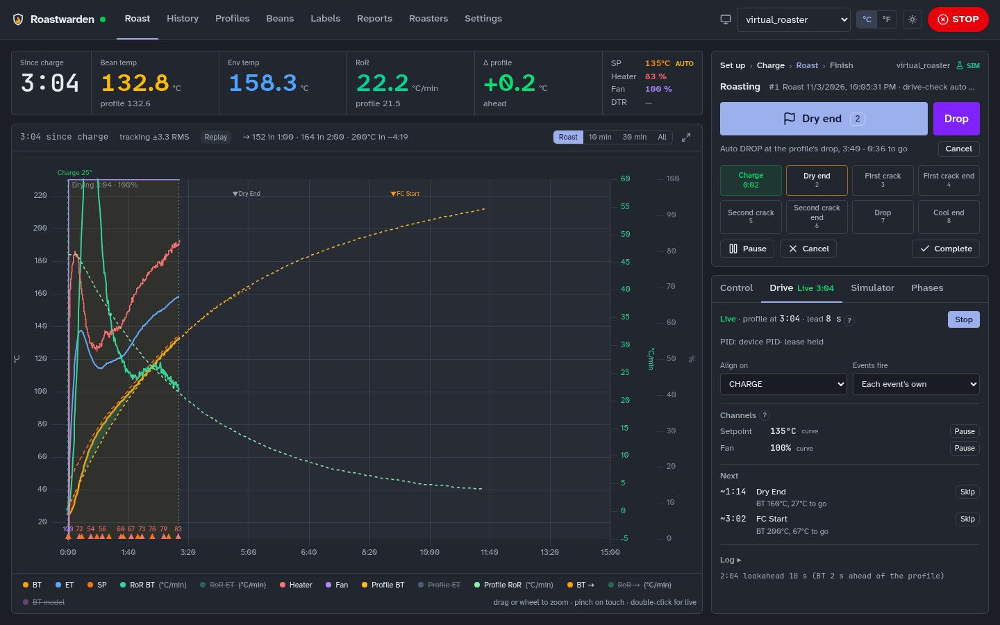

## What it is

The server talks to the roaster and runs the roast: recording, Profile drive, alarms, fan
assist, auto events and the roast sequence. Every browser is a view of it, a laptop by the
roaster and a phone across the room alike, and a roast carries on with no browser open.
Artisan can be one of those views too, if you are used to it (below, "Keep Artisan as a
screen").

The top bar has the sections (Roast, History, Profiles, Beans, Labels, Reports, Roasters,
Settings), the roaster you are looking at, °C/°F, light or dark, and **STOP**, the emergency
stop. STOP is on every page whenever there is something to stop: a roast is open, the
roaster's heater is on or its drum is running, or it is still above its cool-down temperature
(45 °C by default). After an emergency stop the fan runs at full; once the heater is off and
the roaster has cooled, STOP becomes **Fan off**, one tap to quiet it. A cold, idle roaster
shows neither, and nor does one whose control is off.

On a phone the sections are in the menu (☰). While a roast runs and you are on another page,
a chip in the top bar ("Roasting 6:12 · Light espresso") takes you back. A section's link
returns to the page you last had open there; tap the section you are in to get to its main
page.

On a public demo the top bar also says **Demo**: nobody signs in, everyone shares one simulated
roaster and sees each other's roasts, and it starts over every few hours. Settings, roasters
and anything that reaches outside the server stay as they are.

### Modules

Six parts are optional: **Reports**, **Cupping**, **Tuning** (autotune, the gain schedule and
fan assist), **Agents & access** (tokens, approvals, the audit log), **Costs** (prices, cost
per kg and per roast, spending, the shopping list) and **Labels** (Label Studio, a roast's
labels and share page). Settings → Modules turns each on or off, or picks a preset: **Home**
(none of them), **Enthusiast** (reports, cupping, tuning, agents) or **Roastery** (all six).
Off hides a part from the menus and pages; nothing is deleted. A new install opens a
**Welcome** page once to pick the preset, units and time zone. More in
[modules and first run](lean-home.md).

## Setting up

Roastwarden is one container with its own MQTT broker, on any Linux computer, a Raspberry Pi or
a NAS; it can use a broker you already run instead, such as Home Assistant's
([with your own MQTT broker](install-docker.md#with-your-own-mqtt-broker)). [Install](INSTALL.md) has a step-by-step guide for each, with an installer that sets up
Docker too; [your first roaster connection](esp32-starter.md) connects a roaster
through an ESP32 and a thermocouple board, no programming needed.

1. **Open the site** (your server's address). A server with `ROASTWARDEN_READS=open` shows
   everything to read from there; otherwise it shows nothing until the browser signs in.
2. **Sign in with the owner key.** Anything that changes something (control, roasts,
   settings) needs it. The server prints it in its log at the first start and keeps it in
   `owner.key` beside the database. The dashboard asks for it and signs the browser in for 30
   days from its last use; the browser keeps a cookie, not the key. Settings → This browser →
   Sign-in lists the signed-in browsers and signs one out (a lost phone) or all.
3. **Install it on a phone** (optional): the browser's menu → Add to Home Screen (Install
   app). On an iPhone it must be on the home screen for notifications.
4. **Alarm notifications**: Settings → This browser → Alarm notifications → **Turn on for
   this device**, then **Send a test**. Settings → Notifications adds Gotify, ntfy, Matrix
   or a webhook and picks the system events (backup failed, roaster offline, low stock)
   ([push](push.md), [notifications](notifications.md)).
5. **Display**: Settings → This browser has °C/°F, the **weight unit** (g/kg or oz/lb), light
   or dark, and **Heater on charts**: Smoothed draws a 15 s average of the heater instead of
   every jump of the PID.
6. **Roast settings**: Settings → Roasting has the development target, RoR smoothing, the
   profile lookahead, AUC, and the currency, doses and bag size used for costs.
   - **Time zone** is the day a roast falls on for labels, share pages, roasted coffee and
     reports. Unset it is UTC, so a roast at 10 pm in Chicago would print as the next day.
     Your browser's zone is filled in; **Save** keeps it.
   - **Public address** is where share pages, label QR codes and approval links point: the
     address others open the server at (`https://roast.example.com`). Unset, a link takes the
     address its request came to. This page's address is filled in; **Save** keeps it.

### Roasters

Roasters shows a card per roaster with what to check before the day's roasts: **reading** or
**silent** (anything in the last 30 s), its kind, how it connects, its control level and the
check's verdict (click it for the Check tab). Above them, **Found, not added yet** lists
roasters already sending on MQTT or seen on the network: **Add** keeps one as it is, **Set
up** walks through it. The simulators' switches are at the bottom.

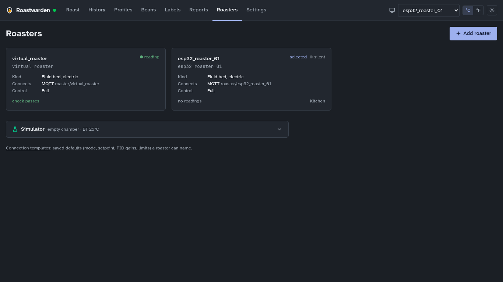

**Add roaster** is four steps ([add a roaster](add-roaster.md)):

1. **Roaster**: its name and its kind. A known machine fills the rest (below).
2. **Connection**: how it connects, in plain words (Wi-Fi over MQTT, a USB TC4 board, a
   controller on RS-485 or on the network over Modbus, a WebSocket), and only the fields that
   way needs. **Advanced** holds the rest. A Modbus roaster's registers are in this step too.
   **Save and check** saves the roaster at **Off · logs only**. Programming your own roaster?
   [Connect your roaster](connect-your-roaster.md) says what to send, with a working example
   for each way in; new to it, start with the [ESP32 starter](esp32-starter.md).
   **Roasters → ESP32 firmware** downloads the starter, or the
   [fluid-bed controller](esp32-fluid-bed.md) for an electric fluid bed, with the roaster's id,
   its password, this server's address and your Wi-Fi filled in: a project for VS Code with
   PlatformIO, which the Arduino IDE opens too. A new roaster's id needs a password first:
   **Make its password** there, or Roasters → **MQTT passwords** (who may sign in to the
   built-in broker, connected or not; a password added there works at once, no restart;
   [MQTT passwords](add-roaster.md#mqtt-passwords)).
3. **Check**: the live check, every 3 s: does it read, at what rate, BT and ET, units,
   outputs. When nothing arrives, **Test the connection**; when the readings are missing or
   wrong, **Map its fields** opens the mapping editor there.
4. **Control**: Off, Manual or Full, and whether this browser roasts with it. **Finish** opens
   the roaster.

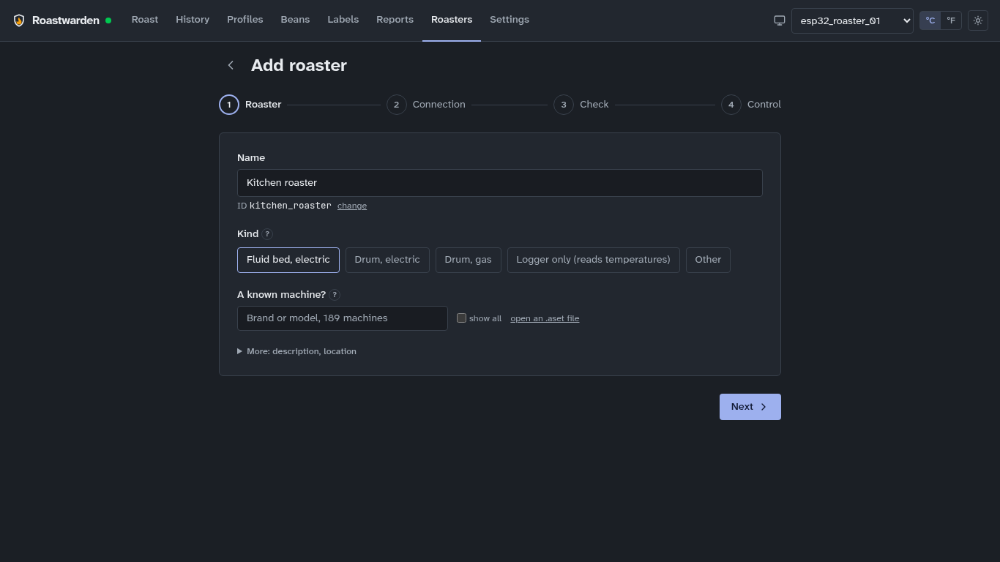

A roaster's page has tabs: **Overview** (the device contract, its model, connections, register
map), **Check**, **Control** (its setup, the PID gains, gain schedule, fan assist, the roast
sequence, and whether tokens may control it), **Autotune**, and for a simulator
**Simulator**. **Edit** changes the name and description and holds **Delete this roaster**
(its roasts stay in History).

**Coming from Artisan?** Add roaster's first step has **A known machine?**: search Artisan's
own machine catalogue (Coffed, Berto, Coffee-Tech, …) or upload your `.aset` file. Roastwarden
reads it the way Artisan does: the connection, BT and ET, the burner, air and drum sliders as
outputs, and the extra curves as channels. You give the serial port or the roaster's address
and check the registers. A note under the choice says what was guessed or left out. Machines
Roastwarden cannot set up yet are listed with the reason
([roasters from Artisan's catalogue](artisan-machines.md), [Phidgets boards](phidgets.md)).

**Keep Artisan as a screen**: Roastwarden runs the roaster, and Artisan reads it like a
Modbus roaster, with its curves, LCDs and saved profiles as before. Switch the server's
Modbus slave on (`ROASTWARDEN_MODBUS_ADDR` in `.env`), then Settings → About → Artisan screen
→ **Setup for Artisan (.aset)**, and in Artisan Help → Load Settings and **ON**. It is read
only unless you allow Artisan's sliders to write ([Artisan as a screen](artisan-screen.md)).

**Setup** (Control, first; [roaster kind and control level](roaster-setup.md)): what kind of
roaster it is, and what Roastwarden may send it.

- **Off · logs only**: it records the roaster and sends nothing, not even STOP. Use the
  roaster's own controls. Profile drive offers a ghost run only.
- **Manual**: heater %, fan %, the heater switch and STOP, and the roast sequence's fan and
  heater steps. Profile drive is ghost only.
- **Full**: everything: setpoint, mode, PID gains, Profile drive, autotune, the gain schedule
  and fan assist.

**A new roaster logs only** until you raise it; raising asks once, so check the roaster's own
safety cutoffs first. The owner key changes it; an agent can turn control off, and switching
it on from an agent waits for your approval (Settings → Approvals). The simulated roaster is
always at Full.

**Kind and outputs.** The kind brings defaults: a fluid bed has a heater and a fan (0–100 %),
a 45 % fan floor while heating and the roast sequence at CHARGE and DROP; a drum has a heater
(or burner) and a fan (or air), no floor, and a sequence that only records; a logger has no
outputs. **Outputs → Edit** sets each output's name, range and step, switches one off, and
sets the fan floor. A drum may also have **Drum** (speed) and **Damper** outputs: switch them
on there when the roaster has them. The Roast page follows the outputs: its sliders carry
their names and ranges.

**A device with its own field names** (a Tasmota or ESPHome board, an Artisan WebSocket
roaster, a TC4 that prints °F, a Modbus controller with its own registers) needs no
reflashing: its connection says how to read it and write to it. Overview → a connection →
**Mapping** edits it: units, a row per field, the command templates, and under them the
newest message the roaster sent and what the mapping makes of it, so you see BT appear in °C
before you save ([mapping a device's own names](ingest-mapping.md)). A Modbus register map's
**Role** column says what each register is; Overview → Register Map → **Edit** changes it.

**Check** (Roasters → the roaster → Check): does the roaster meet the standard? A line each
for the sample rate, BT and ET, the units, each output and channel, what it says it can do,
and its control level, each ok, warn or fail. With the owner key, on a cold roaster with
control on and no roast open, **Write check** sends heater 10 % for up to 5 s, then emergency
stop, and shows each step.

**Channels** (Setup → Channels → Edit): extra values to keep with each roast, such as an
exhaust probe, a TC4's third channel or a burner's gas pressure. Pick a key from what the
roaster sends, name it and choose its unit. A declared channel is drawn on the scope and the
roast's chart, can trigger an alarm, and goes into the Artisan `.alog`. Up to 8
([extra channels](channels.md)).

**After a flash or a restart**, Overview → Device contract says whether the roaster is right:
its firmware, that it sends BT, ET, heater and fan, and whether its PID gains are the ones the
server holds. A roaster that forgets its gains when it restarts gets them back from the
server within a sample or two.

**Model** (Overview): the roaster's thermal model, fitted from its own roasts and refitted
after each one: how far off it is two minutes ahead, where BT levels off at full heater (the
headroom), and how the live prediction did on the last roasts. **Refit** fits it again now
([prediction](prediction.md)).

**Try things on the simulator** first: Roasters → Simulator → On, then pick
`virtual_roaster` in the top bar. It is a fluid bed simulated in the server and runs in real
time. Anything that drives a roaster, from a new profile to autotune, belongs there first.
Beside it, the **simulated drum** is a gas drum that speaks its own MQTT in °F, set up through
the same connection and mapping a real roaster gets ([simulated roasters](virtual-roaster.md)).

**Autotune** (Roasters → the roaster → Autotune): the server's test. Load beans as for a
roast (junk beans do), pick the fan you roast at and a bean temperature where that fan is
used, below first crack, and start. It heats up, swings the heater around the level, and fits
a model to what BT did: about five minutes after the heat-up, and it carries on with the page
closed. The result shows how far to trust it and the PI gains with a **Tight ↔ Smooth** knob.
**Add to schedule** puts it in the gain schedule at the test's fan ([autotune](autotune-2.md)).

## Roasting

The Roast page is the cockpit: the readouts (BT, ET, RoR against the profile, Δ profile,
time, setpoint, heater, fan, development), the scope, and on the right the **Next step**
card with one main button for where the roast is.

1. **Set up.** Pick a profile. If something is planned for this roaster the card says so
   ("Planned 1 of 3: Brazil · 100 g · Light espresso") and the button reads **Start planned
   roast**; Skip or Unplanned roasts something else. Batch details take the bean, green
   weight and notes. A bean never roasted on this roaster adds one line: "New bean: first
   crack near 195 ± 4 °C, about 7:49 ± 30 s".
2. **Start roast** starts recording. Nothing heats yet (a fluid bed is charged cold).
3. **Charge** marks CHARGE and runs the roaster's [roast sequence](roast-sequence.md) (on a
   fluid bed: fan up, heater on), and Profile drive starts if the roast has a profile. The
   card says what Charge will do on this roaster.
4. **During the roast** the card offers the next landmark (Dry end, FC start, …) and
   **Drop** is always one tap; keys 1–8 mark landmarks too. Turning point, dry end and drop
   can be marked by the server (Settings → Alarms, auto events). Near the profile's
   first-crack temperature a toast says **first crack is due**, with a button to mark it:
   listen, and mark it at steady cracking.
   - The **Profile drive** panel shows Live or Ghost, the profile time and the channels;
     touching a control pauses that channel, and Resume hands it back.
   - **Roaster control** has the mode, setpoint, fan and heater by hand.
   - **Phases** shows each phase's time, share of the roast, RoR and AUC as it goes. While
     developing, the scope draws the development window the profile expects, and the Dev
     readout says when DROP gives the target development.
   - **BT model** (a toggle under the scope) draws where the roaster's own model says BT goes
     in the next two minutes, and the readout then gives BT in 1 and 2 min, first crack and
     DROP with their ranges. It also warns before the RoR crashes, flicks up after first
     crack, or BT stalls short of DROP; hover a warning for why ([prediction](prediction.md)).
   - The screen stays on while a roast runs. **Pause** stops the recording only: the roaster
     and the drive carry on.
   - **If the drive stops by itself** (the roaster cut its heater, or the server restarted
     mid-roast) the card says why and offers **Heater on and resume drive**. It picks up at
     the profile time where it stopped. **Roast by hand** hides the banner.
5. **Drop** marks DROP: the drive stops, the heater goes off and the fan cools until BT and
   ET are below 45 °C, then marks COOL END. With **auto DROP** on the profile, a line under the
   main button says when ("Auto DROP at the profile's drop, 10:05 · 1:35 to go"), then counts
   down with a Cancel.
6. **Complete roast**, then enter the roasted weight: the card shows the summary (weight
   loss, development, anything outside what the profile expects) and **Review roast** opens
   it in History. No need to wait for the fan: completed while the roaster still cools, the
   roast keeps recording until COOL END ("Cooling is still recorded" under Saved).

**Cancel** (on the card before Complete) stops the drive and heater, cools if hot, and
deletes the roast. **STOP** cuts the heater at once on the selected roaster.

On a phone the main button sits in a bar at the bottom next to STOP, and the chart makes room
for the curves: narrower temperature and RoR scales without their unit labels, and no 0–100 %
scale (heater and fan show in the readouts and when you touch the chart). A roast's chart in
History does the same on a phone.

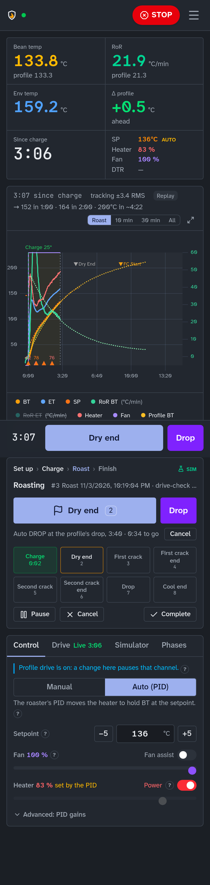

### Alarms

Settings → Alarms holds the alarm rules (a temperature, RoR, time or event condition, then a
message, a sound, a landmark mark or a control change) and the auto events. The server checks
them on every sample of every running roast, so they fire with no browser open, and each
fired alarm goes to every notification channel. Artisan `.alrm` files import and export
there. **Add suggested** adds RoR crash, flick and stall warnings, notify only
([alarms and auto events](alarms.md)).

## After a roast: History

History lists finished roasts with their numbers (batch number, bean, espresso or filter,
time, first crack, development, loss %, colour, how closely BT followed the profile, rating),
sortable, with a dot when loss, colour or development is outside what the profile's level
expects. A roast's page has:

- the chart (BT, ET, RoR, the profile, events) and the phases;
- the numbers against the profile's level and this roaster's own history;
- cupping, on the SCA form ([cupping](cupping.md));
- the coffee's cost per kg roasted and per dose, and notes;
- exports (CSV, Artisan `.alog`) and **Report**, the roast's PDF report.

**Compare** overlays several roasts with a mean ± σ band ([statistics](statistics.md)).

The guidance reads the numbers for you: weight loss, development and colour against the
cited ranges for the profile's roast level; first crack and drop against this profile's own
roasts on this roaster. Amber means outside; at most three lines say what is off
([roast guidance](roast-guidance.md)).

**Next roast of this bean** (while a bean has fewer than three roasts on its profile): where
first crack came against the profile's, how far to move the drop ("move the drop −22 s to
keep it"), development or loss outside the level's range, and **If it tastes…** (sour or
grassy, flat or bready, tipping: what to change) ([a new bean's first roast](new-bean.md)).

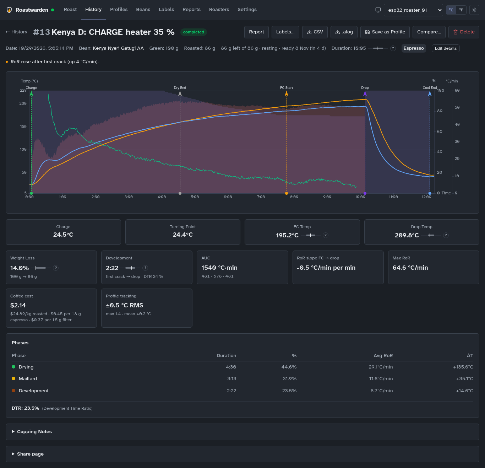

### Labels

**Labels…** on a roast's page makes bag labels on laser sticker sheets (Avery 5163, 6874,
5294 round, or your own) in five designs: plain, gift (with a message), script, ascii and
cherry. It starts from any label of a part-used sheet and previews the sheet as it prints.
The same page opens from **Labels** under the roast summary once the roast is weighed, and
from each roast under Beans → **Roasted coffee**.

- Print the PDF at **Actual size**, then press **Printed it**: the sheet's next free label
  moves on.
- "Best from" is the roast date plus a rest by purpose and level (Settings → Roasting).
- **In the bag** says Whole bean or Ground (with the grind). **Take 3 × 250 g off this
  roast, sold or given** records the bags as packed when you print, for bags that leave you;
  it is off unless you tick it, so labelling the bags you keep changes nothing.
- What a label says the coffee tastes like comes from the coffee's **Label notes** (Beans →
  the coffee → Edit); **Label name** is a shorter name for long ones.
- An agent can design new labels for you ("make Sam a label with a little coffee cup in ASCII
  art") and write label notes. It checks each draft on the server before you see it.

**Labels** in the top bar is Label Studio: every design on sample data. Open one to edit its
Typst source beside a preview that redraws as you type, with what to fix (text past the edge,
too small, overlapping). Save makes a new version. A built-in design is a starting point:
change it and save it under your own name. **Assets** takes your logos, drawings and fonts,
**Brands** your roaster's name, logo and colours, and **Coffees** gives each coffee its own
label. The *shop* design is for coffee you sell: it puts "Whole bean coffee", the net weight
and your name and place where the rules want them.

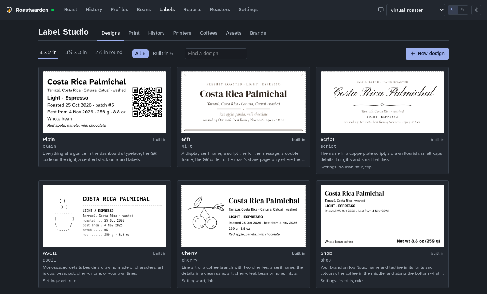

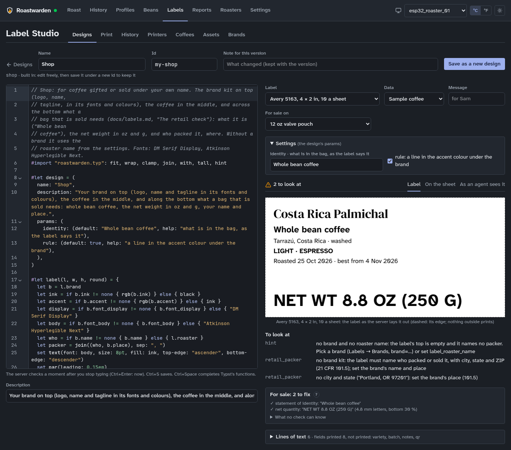

**Print** puts several roasts on one sheet (gift baskets): pick the roasts, give each its
design, copies, weight and message, and see the whole sheet before you print. **History**
keeps every sheet you made with its PDF; **Reprint** makes the same labels again. With a
printer set up (Labels → **Printers**: its address, then **Add**), **Print** sends the labels
straight to it at actual size; each printer has its own tray, colour and calibration per sheet
([bag labels](labels.md)).

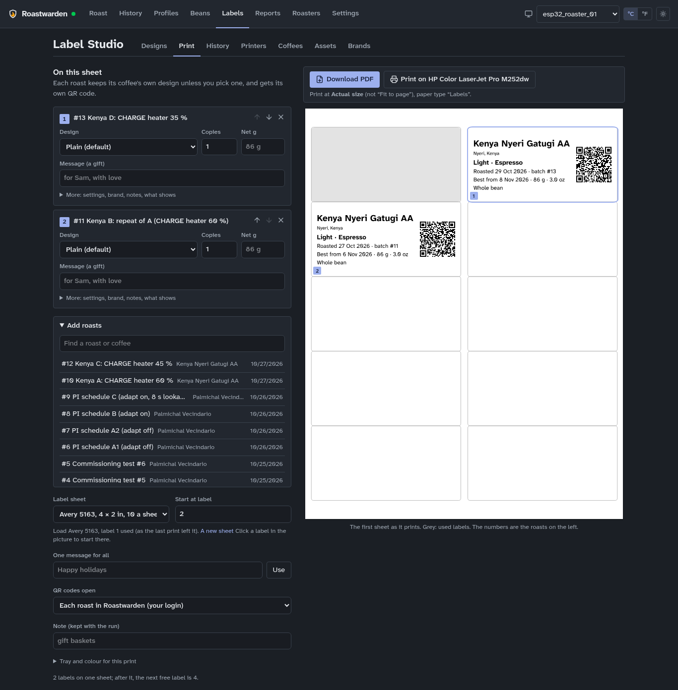

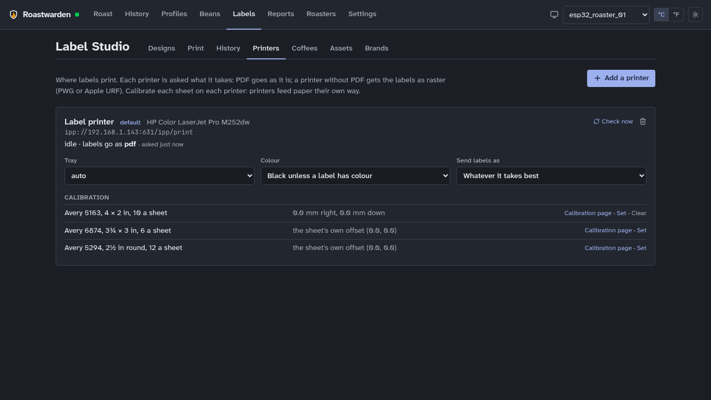

**Share page**: for a bag you give away or sell, the QR code can open a page made for the
person holding it. Choose **QR code opens: Its share page** on the Labels page. The page shows
your brand, a line for them ("Happy birthday, Sam!"), the coffee and where it is from, when it
was roasted and when it is at its best, the tasting notes, the roast curve and how to brew it;
never its cost or stock. A roast's page in History has **Share page**: its address, how often
it was opened, and **Revoke**, after which the page is gone. Anyone with the link can open it;
the code is long and random, and search engines are told to stay out.

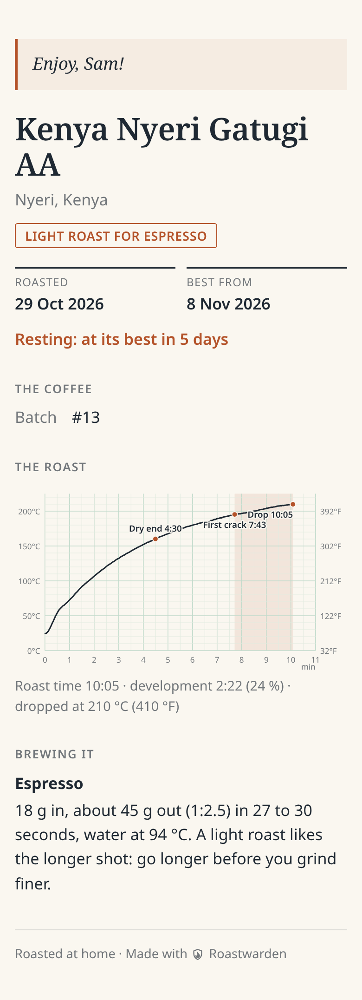

## Reports

**Reports** in the top bar makes PDF documents from your roasting: pick the kind and what it
is about, see the pages as they print, then **Download PDF** or **Open to print**
([PDF reports](reports.md)). Paper and °C/°F are under Settings → Roasting → Reports.

| Report | What it shows |
|---|---|
| Roast report | one roast on a page: the coffee, eight numbers against what to expect, the curve with its phases and events, heater and fan, notes and cupping |
| Compare two roasts | an A/B experiment: both curves and their RoR on one chart, the phases on one time scale, every number side by side with B − A |
| Cupping sheet | a form to score on, each roast under a three-digit code; **Scores** gives a day's cuppings as a table |
| Green inventory | what is in stock with its cost, value and age, and when each coffee runs out; a stock-take sheet to write on |
| Shopping list | one order per supplier with its usual shipping, and what is running low |
| Coffee report, Profile report | a coffee's roasts overlaid, or a profile's roasts ranked against the profile |
| Period report | a month, a range or a year in review |
| Purchases | your orders, with what each kilo cost landed |
| Roast-day plan | the planned roasts with the green to weigh, the profile's targets, how it went last time, and boxes to write in |
| Traceability | a roast back to its green coffee, or a coffee to every bag |

An agent makes the same reports, such as `roast report roast latest`.

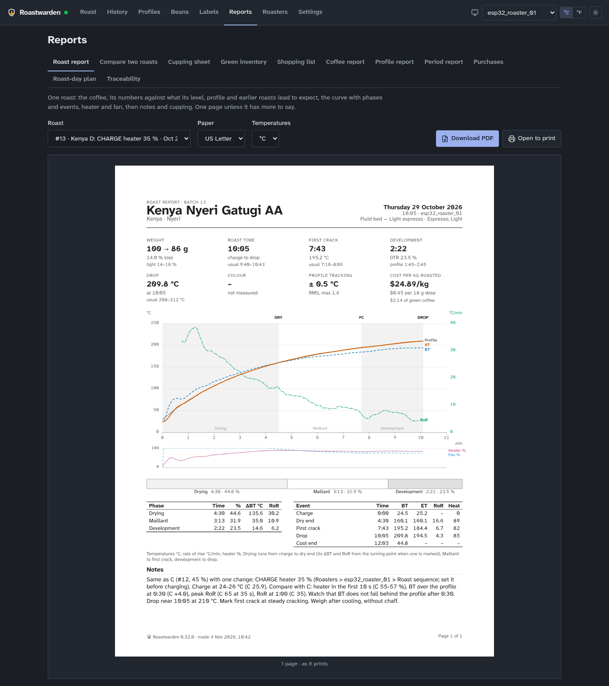

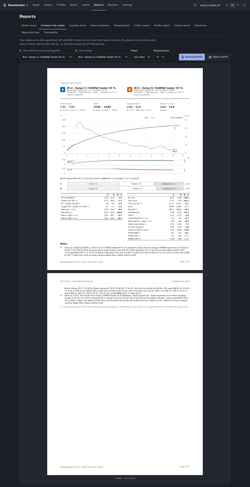

## Profiles

Profiles holds the profiles, the seeds included (fluid-bed espresso and filter profiles at
several levels and two for a drum). The list puts the selected roaster's kind first and marks
the others ("for a drum"). A profile has a BT curve, fan and heater curves, events, a roast
level and a purpose (espresso, filter), and what to expect from it (loss, development,
colour). Its page shows **Roasts on <roaster>**: how its roasts ran and, after a few, what to
change ("First crack came 1:12 earlier … set the FC mark to 195 °C").

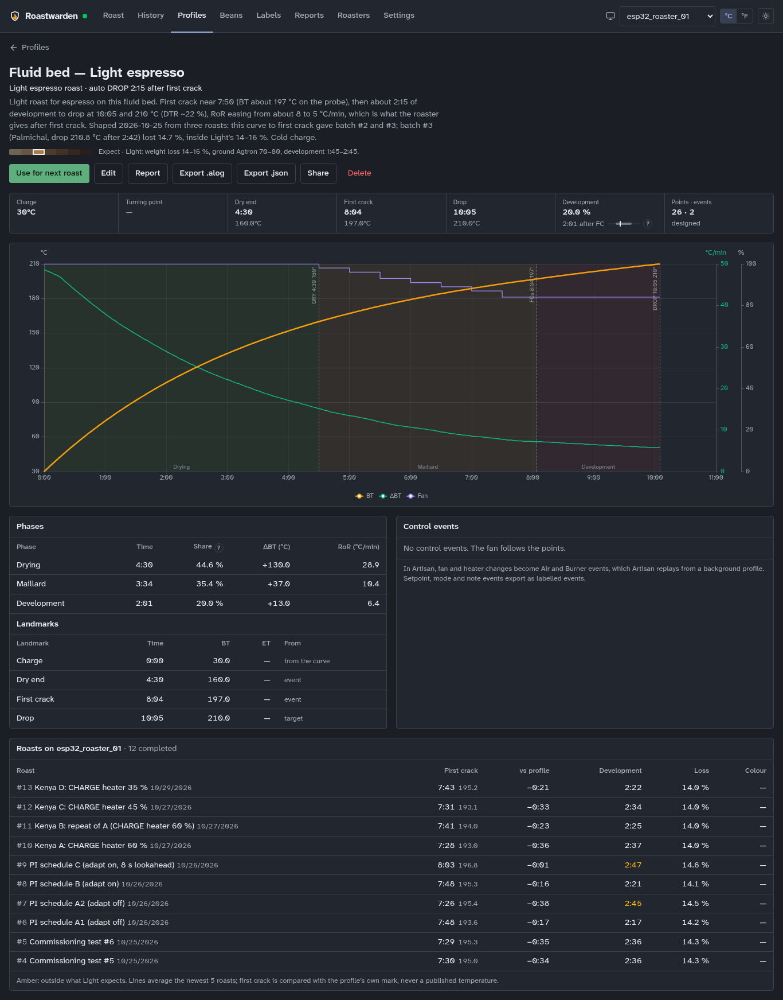

- **Use for next roast** loads it on the Roast page's set-up step.
- **New** draws one in the designer, which judges the curve as you drag (development, phase
  split, results to expect); **Edit** the same for an existing one.
- A finished roast becomes a profile from its page (**Save as Profile**).
- **Auto DROP** (in the editor; off by default): Profile drive marks DROP by itself at the
  profile's drop time, its end temperature or its development time after first crack, after a
  countdown you can cancel ([profile drive](replay.md)).
- **Import** an Artisan `.alog` or a Roastwarden JSON export; **Export** either way.
- **Share** (a profile's page): a public link for a friend on another Roastwarden or on
  Artisan. Its page shows the curve, targets and events and offers the profile as a file;
  never your roasts. **Revoke** takes it down at once.

  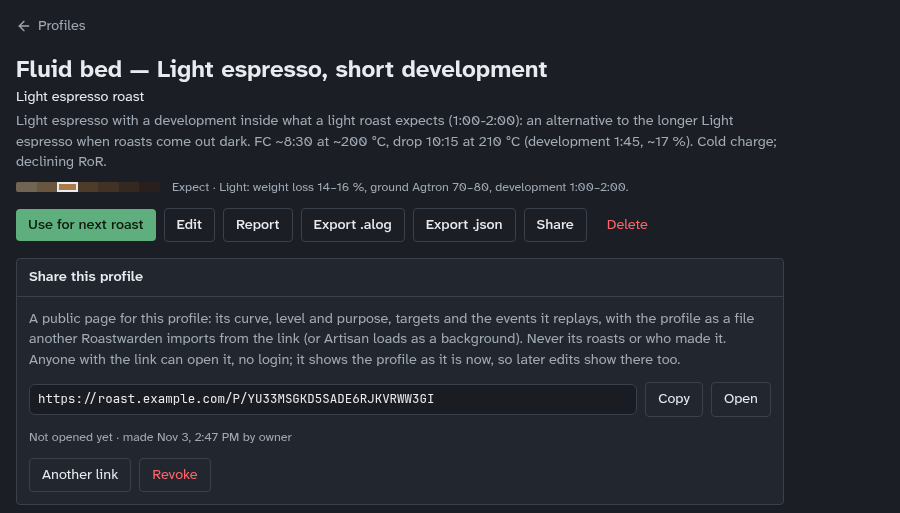

- **Import from a link** (Profiles): paste someone's shared profile link, **Read** to see what
  it is, then **Import it** ([profiles](profiles.md)).

  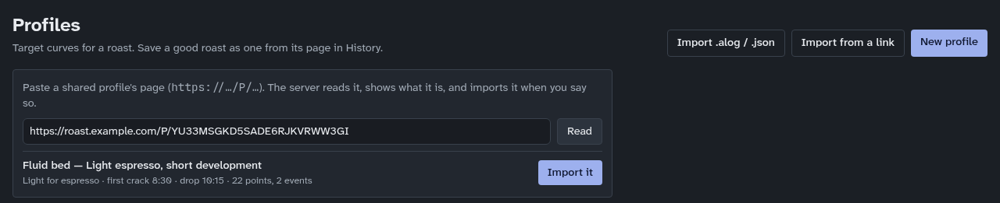

## Beans and costs

Beans opens with **Roasted coffee** (below), then the **planned roasts** queue (bean, green
weight, profile, roaster; a row warns when its bean will not cover it) and the **stock**
table. The **shopping list** shows up once something is on it, and **Spending** by month once
a purchase has a price ([planned roasts and batches](batches.md), [green coffee](green-coffee.md)).

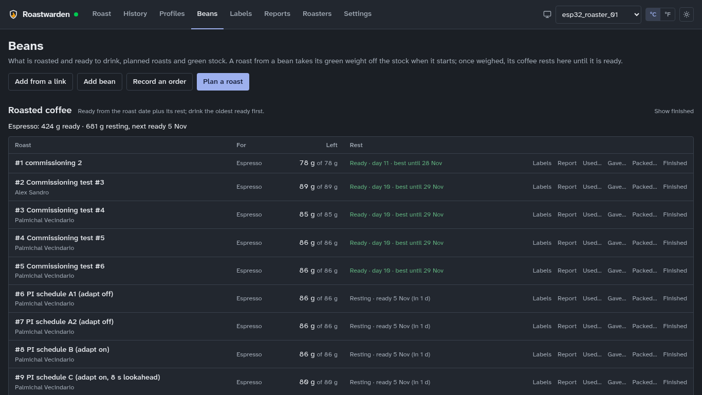

- **A new coffee from a supplier's link**: Beans → **Add from a link**, paste the product
  page (Sweet Maria's, Bodhi Leaf, Theta Ridge, Coffee Bean Corral, Showroom, Happy Mug,
  Burman). The preview has the specs, score and every bag size's price. Save it as a bean,
  put it on the **shopping list**, or **Bought it** to add the bean and its purchase at once.
- **By hand**: **Add bean** (name, origin, process, variety, lot, supplier), then a purchase
  on its page: weight, price, shipping, supplier, date. **Record an order** spreads one
  order's shipping and fees over its coffees by weight.
- **Carts**: Beans → Shopping list → **Carts** gives one link per supplier that opens its cart
  with your bags already in it. You check out there yourself.
- **An order from its receipt**: give your agent the order confirmation email (or a PDF
  invoice). It reads it into an order, and Roastwarden checks it: the lines, shipping and tax
  must add up to what you paid, and the same order is never recorded twice. The order shows
  under **On order**; **Received** on its page puts it in stock.
- **Stock** goes down by itself: a roast draws its green weight from its bean. **Set stock
  to** corrects a count.
- **Cost**: a bean's cost per kg is the weighted average of what is left; a roast's coffee
  cost is its green cost over (1 − weight loss), per kg roasted and per dose.
- **A new bean** (its page, "First roast"): before its first roast on a roaster, what to
  expect, each line with its source on hover: the profile to start from, where first crack
  should come, and what the process or density changes ([a new bean's first roast](new-bean.md)).
- **Low stock**: each bean has a mark (500 g unless set); below it the bean shows Low and,
  if that system event is on, a notification goes out.

### Roasted coffee: resting and ready

Every finished roast with its roasted weight is roasted coffee ([roasted coffee](roasted.md)).
It **rests** until the date its bag label prints as "best from", is **ready** until 35 days
after roasting (28 for darker roasts), then is **past its best**. The top of Beans has one
line each for espresso and filter: what is ready, what is resting and when the next is ready,
and, once you record what you use, how long what is left lasts and the day to roast again.
Each roast's row shows what is left and its state, ready ones first:

- **Used…**: grams, doses, a bag, or all. **Gave…** adds who it went to. **Packed…** records
  bags you packed (`3x250g`, whole bean or ground): they come off what is left but do not
  count as what you drink. **Finished** uses up the rest. Each save has **Undo**.
- **Roasts in one bag**: when two batches of a coffee go into one bag or jar, **One bag with…**
  on either puts them together. They show as one row, and what you take comes off each by its
  share. The bag is ready when its newest roast is, and its label prints both batch numbers
  and the days they were roasted. **Split** separates them again. Batches of different
  coffees in one bag make a **blend**: its row shows each coffee's share, and its label
  prints each origin with its share ("60 % Ethiopia · 40 % Kenya"); write its tasting notes
  on the label yourself.
- A roast you have not weighed shows as **not weighed** for two weeks: weigh it on its History
  page.
- Settings → Roasting sets the rest days, the best-until days and the low mark.
- **Where did this bag's coffee come from?** Reports → **Traceability**: from a roast back to
  its green coffee and everything that happened to the roast, or from a coffee to every roast
  and bag.
- An agent answers "what's ready to drink?" with `roast roasted`, and records "I gave 100 g of
  #12 to Sam" with `roast roasted give "#12" 100g --to Sam`; "#16 and #17 went into one jar"
  with `roast roasted combine '#16' '#17'`.

## Agents, tokens and the command line

`roast` is the command line for Roastwarden ([the roast CLI](cli.md)): status, roasts and
their record, beans, purchases and orders, the plan, profiles, the roasters, notifications,
settings, costs, the audit log and backups. It is in the image and attached to every release
for Linux x86_64 and aarch64. AI agents use it through the Roastwarden skill: "I bought 5 kg
of Ethiopia Guji", a Sweet Maria's link, or "the last roast tasted bright, 4 of 5". An agent
can do what you do in the app, except driving a roaster live, tuning and setting one up,
which stay with you ([agents](agents.md)).

Agents and scripts use **tokens**, never the owner key: Settings → Tokens → New token, with a
name, a preset and an expiry; the secret is shown once.

| Preset | May |
|---|---|
| read-only | read everything |
| inventory | beans, stock, purchases, the shopping list, roasted coffee used or given, and the roast plan; nothing on a roaster |
| roast | what the Roast page does during a roast (start, events, Profile drive, setpoint, fan, heater) and the plan |
| admin | also PID, autotune, fan assist, the roast sequence, profiles, roasters, settings, backups |

Tokens themselves, restoring a backup and the per-roaster switch below are the owner key's
alone.

A token never controls a physical roaster unless you allow it on that roaster (Roasters →
the roaster → Control → "Tokens may control this roaster"). **Ask me first** (on by default for
new tokens) holds starting a roast on a physical roaster and deleting a roast, bean, profile
or roaster until you answer: the request arrives as a notification with a link to Settings →
**Approvals**, where you Approve or Deny ([control](control.md)).

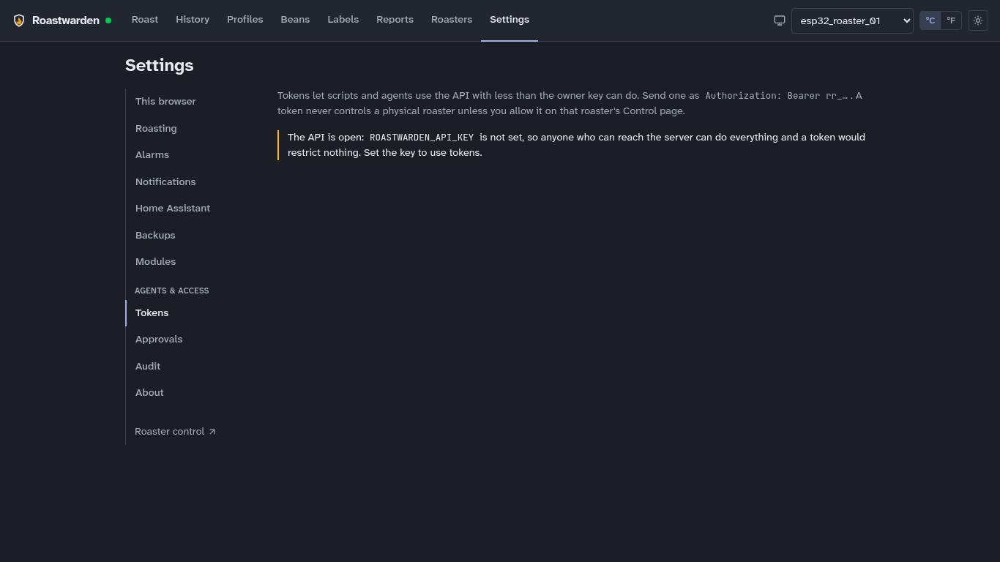

### Audit

Settings → **Audit** lists every request that changed something, refused ones included, with
who sent it (the owner key, which token, the browser or client). Filter by kind, roaster,
token, "Refused or failed only", or search. After an agent has worked, filter by its token to
see exactly what it did; `roast audit --by <token name>` does the same from a shell.

## Home Assistant

Settings → **Home Assistant** shows each roaster in Home Assistant as a device: bean and
environment temperature, rate of rise, heater, fan, setpoint, the roast's phase, roast time,
whether a roast is open and the RoR warning. It is off until you switch it on, and read only:
Home Assistant cannot send a roaster anything. It uses the server's own broker or Home
Assistant's ([Home Assistant](home-assistant.md)).

## Backups and restore

The server copies its database every night at 03:00 UTC and keeps the newest 14. Settings →
**Backups** shows the last copy, the next run and every copy; **Back up now** before anything
big.

To go back: **Check** a copy (whole, a Roastwarden database, a version this server knows,
what it holds), then **Restore…**, which stages it; nothing changes until the server restarts
(`docker restart roastwarden` on the host). The database it replaces is kept beside it.
Restoring needs the owner key: a copy brings its tokens back too ([running it](DEPLOY.md)).

Settings → **About** shows the version, health, the last backup, any open problem (roaster
offline, backup failed, low stock) and the changelog of the running version. When the server
was updated under an open tab, it says "Older than the server: reload the page".

- **Download the support bundle** makes one file for a bug report, with every password, key
  and token removed. Roast names and notes are in it, so read it before you share it
  ([support bundle](support.md)).
- **Licence** links Roastwarden's licence (AGPL-3.0-or-later), the source code of the running
  version and the third-party notices.
- **Roasters** says whether one is in the middle of something a restart would cut: a profile
  drive, an autotune, cooling after DROP, its heater on, or a roast with hot beans. Wait for it
  before you update (`roast busy --wait`, [running it](DEPLOY.md)).

## Where to read more

| For | Read |
|---|---|
| Profile drive, its modes and channels | [profile drive](replay.md) |
| Alarms and auto events | [alarms](alarms.md) |
| The roast sequence (Charge, Drop, Cancel) | [roast sequence](roast-sequence.md) |
| Fan assist, gain schedule, autotune | [fan assist](fan-assist.md), [autotune](autotune-2.md) |
| Guidance and its sources | [roast guidance](roast-guidance.md) |
| Green coffee, costs, supplier links | [green coffee](green-coffee.md) |
| Notifications | [push](push.md), [notifications](notifications.md) |
| Home Assistant | [Home Assistant](home-assistant.md) |
| A support bundle for a bug report | [support bundle](support.md) |
| The command line and agents | [the roast CLI](cli.md), [agents](agents.md) |
| Tokens, approvals, audit | [control](control.md), [security](../SECURITY.md) |
| Running it, backups, restore | [running it](DEPLOY.md) |
