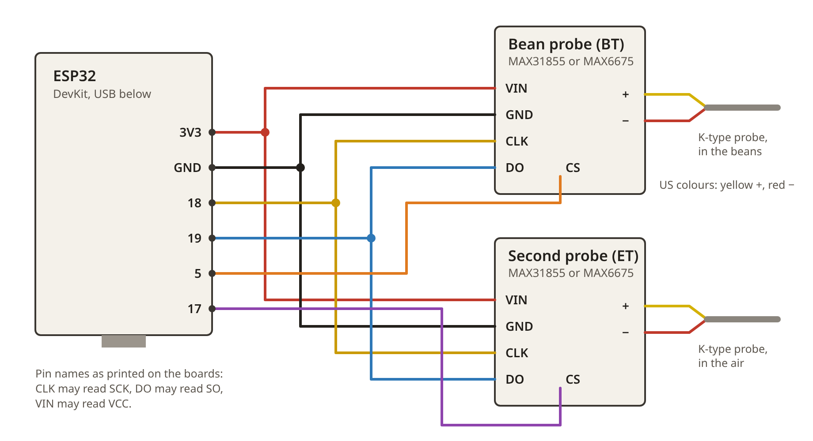
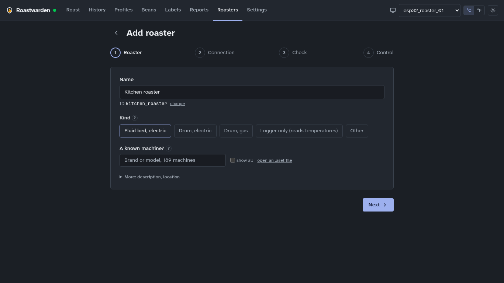

# Your first roaster connection: the ESP32 starter

This guide connects a roaster to Roastwarden with an ESP32, a small Wi-Fi board that costs a
few dollars, and one or two thermocouple boards. It suits a roaster you built yourself, and any
roaster you can fit a temperature probe into. The ESP32 reads the bean temperature (BT), and with
a second probe the environment temperature (ET), and sends them to Roastwarden every second.
It controls nothing: you roast with the roaster's own controls while Roastwarden draws the
curve and the rate of rise, marks the phases and keeps every roast.

No programming is needed: you upload a ready-made program, the **starter sketch**, with a few
settings filled in. Roastwarden can fill them in for you. About an hour the first time, most of
it installing the software that uploads it.

Install Roastwarden first ([install](INSTALL.md)): its installer prints the three settings the
sketch needs.

## What you need

| Part | What to look for | About |
|---|---|---|
| An ESP32 board | "ESP32 DevKit" or "ESP32-WROOM-32 DevKitC", with a USB socket | $5–10 |
| A thermocouple board per probe | **MAX31855** (the better one) or **MAX6675** (cheaper, fine for roasting) | $3–15 each |
| A K-type thermocouple per probe | For the beans, a thin probe (1.5–3 mm) that reaches into the bean mass | $5–15 each |
| Jumper wires | "Dupont" wires, female to female (most boards come with pins to solder on) | $3 |
| A USB cable | One that carries data: some cables only charge | |

One probe is enough to start; a second one for ET (in the air going into or out of the beans)
helps you read the roast.

## 1. Wire it

Both thermocouple boards share the ESP32's clock and data pins; each has its own **CS** (select)
pin. The pin names are printed on the boards. On the ESP32 they read `D18` or `G18` or just `18`.

| Thermocouple board | ESP32 | Wire |
|---|---|---|
| **VIN** or **VCC** (power) | **3V3** | both boards |
| **GND** | **GND** | both boards |
| **CLK** (or **SCK**) | **18** | both boards |
| **DO** (or **SO**) | **19** | both boards |
| **CS** of the bean probe's board | **5** | |
| **CS** of the second probe's board | **17** | |



Then screw each thermocouple's two wires into its board's terminals. Thermocouple wires have a
plus and a minus: on a K-type probe the **red wire is minus** in the US colours (yellow is plus),
white is minus in the European ones (green is plus). Wrong way round, the reading falls when the
probe warms up: swap the two wires.

Power everything from the 3V3 pin, not 5V: the ESP32's pins work at 3.3 volts.

## 2. Set up the Arduino IDE

The Arduino IDE is the free program that sends a sketch to the ESP32. You set it up once.
Already use VS Code? PlatformIO works too: see [with VS Code and PlatformIO](#with-vs-code-and-platformio)
below, and skip this step.

1. Download **Arduino IDE 2** from [arduino.cc/en/software](https://www.arduino.cc/en/software),
   install it and open it.
2. **ESP32 support**: open **Tools → Board → Boards Manager**, type `esp32`, and install
   **esp32 by Espressif Systems**. (Not *Arduino ESP32 Boards*: that one is for Arduino's own
   board.) It is a large download, over a gigabyte: give it a while.
3. **Libraries**: open **Tools → Manage Libraries**, and install, by searching for each name:
   - **PubSubClient** by Nick O'Leary: it talks to Roastwarden;
   - **Adafruit MAX31855 library** by Adafruit, or, for a MAX6675 board, **MAX6675 library** by
     Adafruit. When it asks about the libraries it needs too, choose **Install All**.
4. Plug the ESP32 into your computer. Choose **Tools → Board → esp32 → ESP32 Dev Module**, then
   **Tools → Port** and the port that appeared when you plugged it in (`COM3` or similar on
   Windows, `/dev/cu.usbserial-…` on a Mac, `/dev/ttyUSB0` on Linux).

No new port? Try another cable (a charge-only one shows nothing). Still none: the board needs a
USB driver, named after the small chip next to its USB socket: **CP210x**
([Silicon Labs](https://www.silabs.com/developers/usb-to-uart-bridge-vcp-drivers)) or **CH340**
([WCH](https://www.wch-ic.com/downloads/CH341SER_EXE.html)). On Linux, allow yourself the
serial ports with `sudo usermod -a -G dialout $USER` and sign in again.

### With VS Code and PlatformIO

[VS Code](https://code.visualstudio.com/) with the **PlatformIO IDE** extension (Extensions,
search for PlatformIO) uploads the same sketch. PlatformIO installs the ESP32 tools and the
libraries by itself, from the project's `platformio.ini`, the first time you build. The
download in the next step is such a project. On Linux, allow yourself the serial ports as above.

## 3. Open the sketch and fill in your settings

**The easy way**: in Roastwarden, **Roasters → ESP32 firmware**. Choose **Starter**, check the
roaster's id and the server's address, type your Wi-Fi's name and password, pick your
thermocouple board, and **Download**. Roastwarden fills every setting in, the roaster's password
included (a new id? **Make its password** first), and gives you a zip: unzip it, and

- in **VS Code**: File → Open Folder, the unzipped folder, then **PlatformIO: Upload** (the
  arrow in the bottom bar);
- in the **Arduino IDE**: File → Open, the `.ino` file in its `roastwarden-starter` folder.

Its README.txt has the same steps. Then go on to step 4.

**By hand**: download the sketch,
[roastwarden-starter.ino](https://roastwarden.com/examples/roastwarden-starter.ino). In the
Arduino IDE, **File → Open** it. The IDE asks to put it in a folder of the same name: **OK**.

At the top are the settings to fill in, between the quotes:

```cpp
// ============================== YOUR SETTINGS 1: Wi-Fi ==============================
const char* WIFI_NAME = "your-wifi-name";
const char* WIFI_PASSWORD = "your-wifi-password";

// ============================ YOUR SETTINGS 2: Roastwarden ===========================
const char* SERVER_ADDRESS = "192.168.1.50";
const char* ROASTER_ID = "my_roaster";
const char* ROASTER_PASSWORD = "paste-the-password-here";
```

1. **Wi-Fi**: your network's name and password. The ESP32 joins 2.4 GHz networks only; most
   routers offer one.
2. **Roastwarden**: paste the three lines Roastwarden's installer printed over these three.
   (Run `sh install.sh` again on Roastwarden's computer to see them.)
3. **Your thermocouple boards**: a MAX6675? Put `//` in front of `#define BOARD_MAX31855` and
   remove it from `// #define BOARD_MAX6675`. Only one probe: set `PIN_ET_SELECT` to `-1`. Wired
   to other pins than the table above: change the pin numbers.

## 4. Upload it and watch it work

Click **Upload** (the arrow at the top left). The IDE compiles the sketch, then sends it to the
board: *Connecting…*, then a percentage. Then open **Tools → Serial Monitor** and set it to
**115200 baud** (bottom right). (In VS Code: **PlatformIO: Upload**, then **PlatformIO: Serial
Monitor**, the plug in the bottom bar.) The ESP32 says what it is doing:

```
Roastwarden starter
Wi-Fi: joining "MyWifi" .....
Wi-Fi: connected. This ESP32's address is 192.168.1.71
Roastwarden: connecting to 192.168.1.50 port 1883 as "my_roaster"... connected.
  In Roastwarden it appears under Roasters > Found, not added yet.
BT 21.5 °C   ET 22.0 °C   sent
```

Hold the bean probe in your hand: within a few seconds BT should rise towards 30 °C.

| It says | What to do |
|---|---|
| *Failed to connect to ESP32: Timed out waiting for packet header* (while uploading) | Upload again, and hold the board's **BOOT** button while it says *Connecting…*. Still failing: another cable, or a USB port on the computer itself rather than a hub. |
| *Wi-Fi: not connected after 20 seconds* | The Wi-Fi name or password is off (capitals count), or the network is 5 GHz only. |
| *failed (code -2)*, *Nothing answered* | `SERVER_ADDRESS` is wrong, Roastwarden is not running (`docker ps` on its computer), or the ESP32 is on another network (a guest Wi-Fi). |
| *failed (code 5)*, *turned down the id or the password* | `ROASTER_ID` and `ROASTER_PASSWORD` must match a roaster under Roasters → MQTT passwords (one made there, or the `MQTT_DEVICES` line in `~/roastwarden/.env`). Changed `.env`? In `~/roastwarden`: `docker compose up -d`. |
| *BT: no reading* | The probe is not screwed into its board, or a board wire is loose: check VIN, GND, CLK, DO and CS. |
| BT falls when the probe warms | The thermocouple's two wires are the wrong way round: swap them. |
| BT reads far too high or low at room temperature | A board wire is on the wrong pin, or the `BOARD_` setting does not match the board. |
| Nothing at all in the Serial Monitor | The Serial Monitor's speed is not 115200, or press the board's **EN** (reset) button. |

## 5. Add it in Roastwarden

Open Roastwarden's **Roasters** page. Your roaster is under **Found, not added yet**: click
**Set up**.

1. **Roaster**: give it a name. Kind: **Logger only (reads temperatures)**, as this sketch
   controls nothing. **Next**.
2. **Connection**: already filled in (Wi-Fi, MQTT). **Save and check**.
3. **Check**: Roastwarden reads the roaster for half a minute and judges it. Every line should
   turn **ok**: the rate (one reading a second), BT and ET, the units. (With one probe, the ET
   line is a warning: fine for now.)
4. **Control**: leave it **off**: this roaster takes no commands. **Finish**.



## 6. Your first roast

On the **Roast** page, choose your roaster: BT and ET draw live. Press **CHARGE** when the beans
go in, mark **First crack** when you hear it, and **DROP** when they come out. The
[user guide](USER-GUIDE.md) walks through a roast and everything after it: history, profiles,
beans and labels.

## Making it yours

- **Other pins**: change the `PIN_` numbers. Avoid pins 6 to 11 (the board's memory uses them)
  and 34 to 39 (input only). Safe choices: 4, 5, 13, 14, 16 to 19, 21 to 23, 25 to 27, 32, 33.
- **A different sensor** (a MAX31856, a PT100 board, an analog amplifier): change the function
  `readProbe` and the two lines in `setup()` that create the probes. Everything else stays.
  Roastwarden wants °C.
- **A second roaster**: give it its own id under Roasters → ESP32 firmware and press **Make its
  password**: the download has it filled in, and it may sign in at once
  ([MQTT passwords](add-roaster.md#mqtt-passwords)).
- **Control the heater and fan** of an electric fluid bed: once logging works, the
  [fluid-bed controller](esp32-fluid-bed.md) adds a heater through a solid state relay and the
  fan, a PID on the bean temperature, and the safety a controlled roaster needs: cut-offs for
  over-temperature, a failed probe, too little air and a lost connection. Its guide starts with
  a test with the heating element disconnected. A heater on mains power needs wiring done
  safely, by someone who knows how.

<!-- site: end -->

## Design notes

For developers: how the starter is kept working. The site publishes only the part above.

- The sketch is `examples/roasters/roastwarden-starter/roastwarden-starter.ino`; the site
  serves every example sketch at `/examples/<name>.ino`, so the guide's download is one
  file. Its settings carry the same names the installer
  prints (`scripts/install.sh`).
- Roasters → ESP32 firmware (`/roasters/firmware`, `firmware.rs`, `roast roaster firmware`)
  fills the settings in and zips the sketch as a PlatformIO project; `esp32-fluid-bed.md`'s
  design notes describe it.
- Kept deliberately small: one library besides the thermocouple board's (no ArduinoJson: the
  message is two numbers), no outputs, `caps: []`, its status retained with a last will, the
  MQTT failure codes (PubSubClient `state()`: 4 and 5 are the broker refusing the id or
  password; Roastwarden's broker answers 5) explained on the Serial Monitor in plain words.
- `connect_examples.rs`'s `the_starter_example` adds `roaster.json` (kind logger) and expects
  the check ok with nothing sent; `examples/build.sh` compiles it for a MAX31855 and,
  switched over, a MAX6675.
- Checked against a fresh install: the installer's printed settings, a client publishing the
  sketch's messages, the roaster found, set up as a logger, the check ok (`INSTALL.md`'s notes).
  Not yet on a physical ESP32 with the boards.
