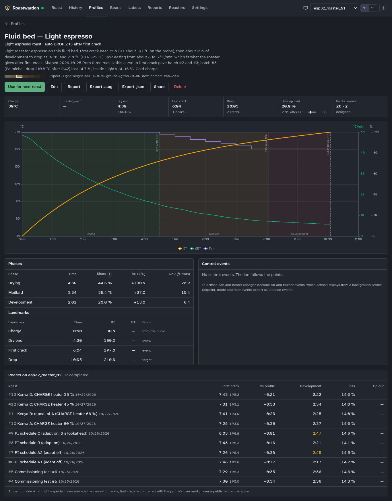

# Seed profiles

A profile is a target for a roast: a bean temperature curve, with the fan and heater if it
has them, events to replay (a fan step at 4:00), landmarks such as first crack, and the
targets for charge and drop. The Roast page draws it on the scope from CHARGE,
[Profile drive](replay.md) can roast from it, and each roast on it is read against it.

## Getting a profile

- **The seed profiles** come with a new install (below).
- **New profile** on the Profiles page opens the designer: click on the chart to add points,
  drag them to move them, or switch to the table to type them. Add events under Events, each
  fired by time or by BT.
- **Save as Profile** on a roast's page in History turns a good roast into one: its curve,
  heater and fan, events, and the whole recorded curve as a background.
- **Import .alog / .json** on the Profiles page takes an Artisan roast or a Roastwarden
  profile file ([below](#artisan)).
- **Import from a link** takes another Roastwarden's shared profile ([below](#sharing)).

A profile's page (Profiles → the profile) shows its curve, phases, landmarks, the events it
replays and its roasts against it, with **Edit**, **Report** (a PDF, [reports](reports.md)),
**Export .alog**, **Export .json**, **Share** and **Delete**.

In the editor, set its roast level and purpose so its roasts are judged against the right
ranges ([roast guidance](roast-guidance.md)), its batch size, and **Auto DROP** once the
profile is dialed in ([Profile drive](replay.md)). First crack is the FC landmark event; the
drop time is the curve's end.

## The seed profiles

Seven for an electric fluid bed charged cold, at room temperature, and two for a small gas
drum charged hot:

| Profile | Level · purpose | First crack | Drop |
|---|---|---|---|
| Fluid bed — Light (filter) | light · filter | 7:45 | 9:30 @ 210 °C |
| Fluid bed — Medium (filter) | medium · filter | 8:30 | 11:00 @ 216 °C |
| Fluid bed — Light espresso | light · espresso | 9:00 | 11:30 @ 212 °C |
| Fluid bed — Light espresso, short development | light · espresso | 8:30 | 10:15 @ 210 °C |
| Fluid bed — Extra-light filter (Nordic) | extremely light · filter | 7:30 | 8:30 @ 205 °C |
| Fluid bed — Medium-light omni | medium light · omni | 8:15 | 10:15 @ 213 °C |
| Fluid bed — Cupping (SCA sample roast) | medium light · other | 8:00 | 10:00 @ 213 °C |
| Drum — Light (filter) | light · filter | 8:15 | 9:45 @ 205 °C |
| Drum — Medium omni | medium · omni | 8:45 | 11:00 @ 211 °C |

The fluid-bed curves put first crack at 200 °C, the drum ones at 196 °C. Every seed sits
inside its level's development and DTR ranges except Light espresso, which plans a longer,
gentler development on purpose (the profile page shows it in amber); its short-development
sibling is the one to use if roasts on it come out dark. Auto DROP is off on all of them. Three
older examples, "Generic … (legacy, drum-style)", come with it too: their charge and fan suit
neither roaster.

They are a starting shape, not settings to copy: a fluid bed's bean probe sits in hot air and
reads higher than a drum's, and a drum's burner and air percentages are its own. After a few
roasts with first crack marked, move the curve to match your roaster, or save a good roast as
a profile.

### For a kind of roaster

A profile can say which kind of roaster it is for (the editor's **For a kind of roaster**:
fluid bed, drum, or Any). The Profiles list puts the selected roaster's kind first and marks
the others "for a drum" or "for a fluid bed"; nothing is hidden. A profile saved from a roast
takes its roaster's kind; an Artisan import has none.

## Artisan

**Export .alog** writes a file Artisan opens as a roast, or loads with Roast → Background to
roast against it and replay its events. The fan and heater go out as Artisan's Air and Burner
events, and dry end, first crack and drop as its landmarks. **Import .alog / .json** goes the
other way: an Artisan roast becomes a profile with its landmarks, Air and Burner events, and
its beans, batch weight and roaster. A profile with no points cannot be exported.

## Sharing

**Share** on a profile's page, then **Make a share link**, gives a public address,
`https://your-server/P/<code>`, for someone who roasts on another Roastwarden or on Artisan.
The page shows the curve, the level and purpose, the roaster kind, the targets and the events
it replays, and offers it as `profile.json` (Roastwarden) and `profile.alog` (Artisan). It
shows the profile as it is now, so later edits show there too. It never shows who made it or
its roasts.

- **Another link** makes a second one, so one person's can be revoked on its own. **Revoke**
  makes the page and files a 404 from then on. Views and downloads are counted, without
  addresses.
- The links use Settings → Roasting → **Public address** when it is set. The page needs no
  login, so a login proxy in front of the server must let `/P/` through.

To import one, Profiles → **Import from a link**: paste the page's address, **Read** shows
what it is, **Import it** saves it. The server fetches it itself, only over `https://` and only
from a public address, and the new profile's description says where it came from.

## From the command line

`roast profiles` lists them; `roast profile show | history | edit | save | import | export |
share | shares | unshare | import-link | rm` do the rest ([the roast CLI](cli.md)). Changing
profiles needs an admin token.

<!-- site: end -->

## Design notes

For developers: how profiles, their seeds, sharing and the Artisan files work. The site
publishes only the part above.

Migrations 014, 015 and 021 ship seven profiles made for this roaster: a fluid bed that
is charged cold (beans in the chamber at room temperature) and is
heat-limited at full airflow. They replace the original generic examples,
which stay in the database for the sessions that reference them, renamed
"Generic … (legacy, drum-style)". Those started at a 95 °C charge and ran
the fan at 45–75 %, too low for the fluid bed.

| Profile | Level · purpose | FC | Drop | Development | RoR start → FC → drop (°C/min) |
|---|---|---|---|---|---|
| Fluid bed — Light (filter) | light · filter | 7:45 @ 200 °C | 9:30 @ 210 °C | 1:45, ~18 % | 54 → 6.8 → 4.8 |
| Fluid bed — Medium (filter) | medium · filter | 8:30 @ 200 °C | 11:00 @ 216 °C | 2:30, ~23 % | 48 → 7.4 → 5.6 |
| Fluid bed — Light espresso | light · espresso | 9:00 @ 200 °C | 11:30 @ 212 °C | 2:30, ~22 % | 50 → 5.7 → 4.1 |
| Fluid bed — Extra-light filter (Nordic) | extremely light · filter | 7:30 @ 200 °C | 8:30 @ 205 °C | 1:00, ~12 % | 57 → 5.8 → 4.3 |
| Fluid bed — Cupping (SCA sample roast) | medium light · other | 8:00 @ 200 °C | 10:00 @ 213 °C | 2:00, ~20 % | 51 → 7.6 → 5.6 |
| Fluid bed — Light espresso, short development | light · espresso | 8:30 @ 200 °C | 10:15 @ 210 °C | 1:45, ~17 % | 50 → 6.5 → 5.0 |
| Fluid bed — Medium-light omni | medium light · omni | 8:15 @ 200 °C | 10:15 @ 213 °C | 2:00, ~20 % | 50 → 7.5 → 5.7 |

Every seed sits inside its roast level's development and DTR ranges (`docs/roast-guidance.md`;
`lib/guidance/profile.test.ts` checks it) except **Light espresso**, which plans a longer,
gentler development (2:30 against light's 1:00–2:00) on purpose; the editor and the profile page
show it in amber. Its short-development sibling is the alternative when roasts on it come out
dark, as a recorded roast on it did. Migration 021 added the last four, seeds of the project's
own rather than a third-party library (none could be bundled, below), and moved Light (filter)
from very light to light, which its curve is. The cupping roast follows the SCA sample-roast
window (8–12 min, about Agtron 63 ground).

The seeds aim at light roasts for espresso and light or medium ones for
filter, so migration 015 replaced the first set's medium-dark
espresso with a light espresso profile: a light drop temperature with a
longer, gentler development, so it extracts sweet rather than sour.

How they are built (`scripts/gen_fluid_bed_profiles.py`, which writes an
upsert migration so a new one can change deployed curves):

- BT follows a declining rate of rise, `RoR(t) = c + a·e^(−t/200 s)`,
  integrated from 30 °C at CHARGE and fitted so first crack lands at 200 °C
  and the drop at its temperature. RoR never rises (no flick or crash
  built in). Points every 30 s, so the linear interpolation the replay uses
  stays smooth.
- Fan 100 % through drying (to 4:00), then easing to 82/80/78 % by first
  crack: the practice on this roaster. With fan replay on, that is the ceiling and
  fan assist trims below it when the heater is pinned (never under 70 %).
- Auto DROP off (`replay.md`, "Auto DROP"): a profile is switched to it once dialed in.
- Landmark events: DRY at 160 °C and FC at 200 °C, so the scope's FC
  target and ETA use them.

The first-crack temperature (200 °C) is an estimate for this probe; a
fluid-bed bean probe sits in hot air and reads higher than a drum probe.
After a few roasts with FC marked, shift the curves to match (new
migration, or save a good session as a profile).

The scope draws the profile BT and, from it, the profile RoR (dashed, on
the RoR axis); the readout shows `RoR live / profile`.

Third-party profiles: the best fluid-bed source (Kaffelogic's profile
library) has no redistribution licence. GPL-3.0 sources exist (Openroast's
Fresh Roast recipes, elkayem/CoffeeRoaster); none are bundled: the seed profiles are
Roastwarden's own, one set per roaster kind.

## Sharing a profile

A profile can have a public link (migration 058, `profiles/share.rs`), `<public_url>/P/<code>`,
for someone who roasts on another Roastwarden (or on Artisan), the way a roast's share page is
for the person holding a bag (`labels.md`, "The share page"):

- **The page** shows the profile as it is now (later edits show there too): the curve on
  chart paper (dry end, first crack and drop marked, development shaded), the level and
  purpose, the roaster kind it is for, its targets (charge, first crack, drop, drop
  temperature, batch, the coffee it was made for, auto DROP) and the events it replays
  ("4:00 · fan 85 %"), then the two files. No script, nothing loaded from elsewhere, not
  indexed, not cached; the brand kit's name and place when the `label_brand` setting names
  one. Never its id, who made it, or its roasts.
- **The files**: `/P/<code>/profile.json`, the profile as a `roastwarden.profile/1` document
  (the flat form `POST /api/profiles/import/artisan` reads; no ids, no author; a background
  curve's source roast left out), and `/P/<code>/profile.alog` for Artisan (a fresh
  `roastUUID`, not the profile's id). Readable from any site (`Access-Control-Allow-Origin: *`).
- **The code** is a roast share link's kind: 25 base32 characters (125 random bits). One link
  per profile unless the owner makes another (`new`); **revoking** makes the page and files
  the same 404 as a code that never was. Views and downloads are counted, without
  addresses. Deleting a profile deletes its links.
- **Import from a link** (`POST /api/profiles/import/link`, `{url, name?, preview?}`): the
  page's address or one of its files'. A link to this server (its `public_url` or the
  address the request came to, host and port) or a bare code is read from the database; any
  other must be `https://`, and the server fetches its `profile.json` with care, since this is
  a request from the server: the host is resolved once and every address it gives must be
  public (no loopback, private, link-local, CGNAT, documentation, multicast or reserved range,
  and no IPv4 hidden in IPv6), that address is pinned for the request so a second lookup
  cannot point elsewhere, no redirects, 10 s, 2 MB. A file that does not say
  `roastwarden.profile/1` is refused. The new profile's description ends with "Imported from
  <link> on <date>."; `preview` reads it and saves nothing. 404 `LINK_NOT_ACTIVE` when the link is not active
  (here or there), 502 when the other server cannot be read.
- **Who**: reading the links is for every token; making and revoking them and the import are
  admin's (a link makes a profile public; the import makes one). The page and files need no
  login, so behind a proxy that signs people in they need a router of their own outside the
  login, like the share page's.

`GET|POST /api/profiles/{id}/share` (`{new?}`), `GET /api/profile-shares[?all=true]`, `DELETE
/api/profile-shares/{code}`. Dashboard: a profile's page → **Share**; Profiles → **Import from a
link** (Read shows what it is, then Import it). Agents: `roast profile share | shares |
unshare | import-link` (`docs/cli.md`).

## Tuned to a roaster

The seeds above are what a new install gets. Three recorded roasts of two coffees on
`esp32_roaster_01` showed what they need on a real fluid bed, and its server's profiles were
changed through the API to match:

- **First crack** came near 7:50 every time, with BT 194.5–198.5 °C on the probe, 2–3 °C above
  the curve, earlier than the seeds' 200 °C mark. Every fluid-bed profile's first crack mark
  went to 197 °C at the time its curve reaches 195 °C (Light espresso: 7:50, its observed time).
- **After first crack** the roaster gives about 8 °C/min easing to 5 °C/min (heater 80–100 %,
  fan assist near its floor), less than the seeds assumed.
- **Light espresso** became the curve that gave the second and third roasts (the seeds' "Light
  espresso, short development", renamed, so those roasts stay linked) with its drop moved to
  10:05 at 210 °C, about 2:15 after first crack. The third roast dropped at 210.8 °C after
  2:42 and lost 14.7 %, inside Light's 14–16 %. The seeds' Light espresso (first crack ~9:00,
  drop 11:30 at 212 °C), which gave the first roast (4:06 of development, 21.7 %), was
  deleted; that roast keeps its level and purpose.
- **Medium espresso** (added): the same curve to first crack, then about 3:00 to drop at 10:50
  and 212.5 °C. A first estimate between the third roast and the first; adjust by the first
  roasts' weight loss (Medium: 15–18 %).
- **The filter, omni, Nordic and cupping profiles** got the new first crack mark only; their
  curves after it are unchanged and were not roasted on it, so their planned development reads
  35–45 s longer than designed (amber on their pages) until a roast of each tunes it.

The repository's seed migrations are unchanged: a new install still starts from the seeds.

## Roaster kinds

A profile may name the roaster kind it was written for, `roaster_kind` (migration 051): one of
the setup kinds ([`roaster-setup.md`](roaster-setup.md): `fluid_bed_electric`, `drum_electric`,
`drum_gas`, `logger`, `other`), or none, which fits any roaster. The fluid-bed seeds above say
`fluid_bed_electric`; the drum seeds below `drum_gas`. A profile saved from a roast takes the
kind of the roaster it was roasted on; an Artisan import has none (the `.alog` gains no key);
a Roastwarden `.json` export carries it.

The profile library (`lib/profile/kind.ts`) lists the selected roaster's kind first and marks a
profile written for another kind with a small label, "for a drum" or "for a fluid bed"; nothing
is hidden. Electric and gas drums count as one ("for a drum"); a profile with no kind is never
marked and keeps its place. Until the roaster's setup has loaded nothing moves; for a logger or
"other" roaster the order is kept and the seeds are marked. Set it in the profile editor ("For
a kind of roaster"), `PUT /api/profiles/{id}` (`roaster_kind`, absent keeps it, `null`
clears it, an unknown kind is a 400) or `roast profile edit <profile> --kind drum-gas` (`any`
clears it).

## Drum seeds

Migration 051 adds two profiles for a small preheated drum, written from published drum
practice, generated by `scripts/gen_drum_profiles.py` (an upsert, like the fluid-bed generator):

| Profile | Level · purpose | Charge | TP | Dry end | FC | Drop | Development | RoR TP → FC → drop (°C/min) |
|---|---|---|---|---|---|---|---|---|
| Drum — Light (filter) | light · filter | 200 °C | 1:25 @ 97 °C | 4:17 @ 150 °C | 8:15 @ 196 °C | 9:45 @ 205 °C | 1:30, ~15 % | 21 → 7.5 → 4.5 |
| Drum — Medium omni | medium · omni | 205 °C | 1:30 @ 100 °C | 4:37 @ 150 °C | 8:45 @ 196 °C | 11:00 @ 211 °C | 2:15, ~20 % | 18 → 8.2 → 5.1 |

- **BT**: from the charge down to the turning point (a parabola, as the probe falls into the
  cold beans), then a rate of rise that declines linearly in time, fitted through first crack
  and the drop. Points every 30 s plus the landmarks and each output step.
- **Burner and air** (the points' heater and fan, so the Artisan export writes them as Burner
  and Air events at each step): step changes, as drum roasters make them. Light: burner 65 %,
  60 % at 6:15, 55 % 30 s before first crack; air 40 %, 50 % at the dry end, 60 % before first
  crack. Medium: burner 65 %, 60 % at 5:00; air 30 %, 40 % at the dry end, 50 % before first
  crack. They are percentages of the roaster's own range, so they are a starting shape, not
  settings to copy onto another machine.
- **Landmarks**: CHARGE, TP and DROP by time, DRY (150 °C) and FC (196 °C) by BT.
- Both sit inside their level's development and DTR ranges (`docs/roast-guidance.md`; the
  dashboard's `lib/guidance/profile.test.ts` and the server's seed test check it).

Sources:

- Scott Rao, ["Roast development time and the prerequisite for any successful
  roast"](https://dailycoffeenews.com/2014/08/12/roast-development-time-and-the-prerequisite-for-any-successful-roast)
  (Daily Coffee News, 2014): first crack at 75–80 % of the roast, development 20–25 % (the
  medium); a light roast dropped early in first crack sits below it.
- Scott Rao, ["The flick, updated for 2021"](https://www.cropster.com/blog-post/the-flick-updated-for-2021/)
  (Cropster): a typical drum roast is 10–14 minutes; a smoothly declining RoR; never more gas
  in first crack (the burner only steps down here).
- Green Coffee Collective, ["How to master roasting on an Aillio
  Bullet"](https://greencoffeecollective.com/blogs/learn/how-to-master-roasting-on-an-aillio-bullet):
  first crack 198–200 °C; a light filter roast ends at 205–209 °C after 8:30–10:30 with 1:25–1:45
  above 198 °C; light/medium espresso 209–212 °C, 10:30–11:30, 1:50–2:20.
- Seelaz Barista Academy, ["Roast profile development, from charge to
  drop"](https://seelaz.com/blogs/barista-academy/roast-profile-development): charge
  180–220 °C, turning point 85–100 °C at 1–2 min, drying to ~150 °C in 4–5 min, first crack
  ~196–205 °C, DTR light 15–18 %, medium 19–22 %.

**Checked on the simulated drum** (`virtual_drum`, [`virtual-roaster.md`](virtual-roaster.md)):
Profile drive of a drum's burner and air is not built, so the
check runs the drum's own model open loop: preheated at 40 % air to the profile's charge BT
(burner about 53–55 %), charged, then the profile's burner and air steps second by second.
`virtual_drum.rs`'s `the_drum_seeds_run_open_loop_on_the_simulated_drum` holds it to within
10 °C of the curve from the turning point on, first crack within 45 s and the drop within
6 °C. Measured: Light turns at 1:26 / 97 °C, dries at 4:20, cracks at 8:10 and
drops at 201 °C, at most 7 °C off; Medium turns at 1:28 / 98 °C, dries at 4:20, cracks at
8:24 (21 s early) and drops at 207 °C, at most 7.4 °C off. The simulator runs a little hot
in Maillard and slow after first crack (its drum's heat carries the beans, and a burner step
shows late), which is why the steps are small.

# Artisan profiles (import and export)

Profiles → **Import** takes an Artisan roast (`.alog`) or a Roastwarden
`.json` export. The roast becomes a profile the way a recorded session
does (points every 30 s, landmark events, Air/Burner events as fan and
heater, the recorded curves as a background). Artisan's `beans`, `weight`
(in) and `roastertype` become the profile's beans, batch size and roaster.

A profile's page has **Export → Artisan .alog**
(`GET /api/profiles/{id}/export/artisan`, `artisan::build_profile_alog`).
Open it in Artisan as a roast, or load it with *Roast → Background* to
roast against it and replay its events:

- BT and ET every second from CHARGE, a monotone spline through the
  points (no overshoot, so Artisan's RoR has no ripples the points do not
  have). Recorded curves fill in only where the points have no values.
- `timeindex`: DRY, FCs, FCe, SCs, SCe, DROP and COOL from the profile's
  landmark events (by time, or where the curve reaches their BT), FCs from
  the first-crack target if there is no event, DROP from the drop event,
  else the total time, else the last point. Artisan skips background
  events after DROP.
- Fan and heater (points and events) become **Air** and **Burner** special
  events, the types Artisan's background playback replays. Setpoint, mode
  and note events become labelled `--` events.
- `beans`, `weight` (batch size in g), `roastertype`, `roastingnotes`
  (the description) and a `roastUUID` from the profile id.

Compatibility notes (from Artisan 4.2.1's loader):

- `version` is written as `2.10.0`. Official Artisan builds check a
  signature on files that claim 4.2.0 or later and refuse unsigned ones as
  backgrounds; older versions are not checked.
- No `extra*` keys: an empty extra-device list in a file would replace the
  extra-device setup of the Artisan that opens it. The one exception is a roast from a
  roaster with declared channels ([`channels.md`](channels.md)): one `+Virtual` extra device
  per pair of channels, the keys Artisan writes with it, `-1` for a missing value; Artisan
  backs up the user's own extra devices when it loads such a file and restores them on RESET.
- No `None` in `timex`/`temp1`/`temp2` (Artisan types them `list[float]`);
  a missing value is `-1`.
- Event values use Artisan's encoding: 0 % is `0.0`, p % is `p/10 + 1`.
  The importer keeps 0 % events (a burner cut, for example).
- A recorded roast's batch number (`batches.md`) goes out as `roastbatchnr`
  (`roastbatchprefix` empty, `roastbatchpos` 1); the import ignores it.

Every export of the seed profiles and a recorded session passes Artisan's
own `TypeAdapter(ProfileData)` validation, and Artisan's sample roasts
import with their landmarks, burner/air events and metadata. A legacy
profile with no points cannot be exported (422).
